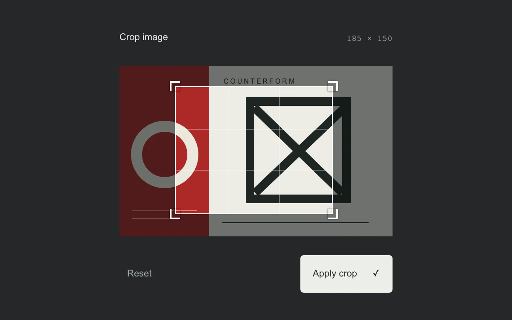

# Crop window

> A movable crop frame trims a bold modular artwork with direct corner controls.

- **Common name:** Image crop tool
- **Category:** Components & interactions
- **Live demo:** https://www.subframe.com/motion/crop-window
- **Source:** Subframe (original, MIT)
- **Dependencies:** none

## Use case

Refine composition with a bounded crop that can be previewed and revised.

## Interaction

Drag the frame or its corners, use arrows with optional Shift, and apply the crop.

## Look

Charcoal editor showing a red, cream and black geometric graphic under a white thirds-grid crop frame with corner brackets, dimmed outside, plus pale buttons.

## Motion

Dragging the frame or a corner moves or resizes the crop with no easing, clamped to the artwork; arrow keys step 2 or 10 units, and applying reframes instantly.

## How to adapt

Geometry lives in `adjust` (clamps to 320×200, minimum 80×70) driven by `begin`, `move` and `end` with pointer capture; applying swaps the SVG `viewBox` to the `box`. Replace `CropArt` with your image and map `box` to real pixel coordinates.

## Reduced motion

Direct manipulation stays immediate; there is no automatic camera or crop motion.

## Limitations

Crops a local SVG illustration through its viewBox. No image-file export, rotation, fixed aspect ratio or pinch zoom.

## Taxonomy

- **Components:** image, editor
- **Triggers:** drag, keyboard, press
- **Techniques:** mask
- **Feel:** technical, subtle
- **Contexts:** app
- **Tags:** crop, resize, drag, pointer-capture, bounded, geometry, keyboard, image
- **Also known as:** image cropper, resizable crop box, photo crop handles, rule-of-thirds crop overlay
- **Surface color:** `#252728`

## Code

See [`component.tsx`](component.tsx).
