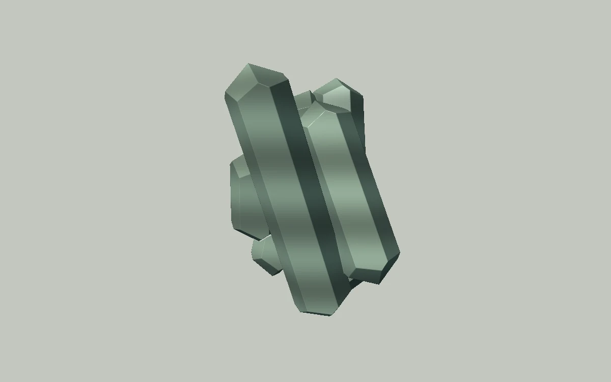

# Crystal growth

> A smoky quartz cluster reveals sharp facets as its proportions change.

- **Common name:** Crystal raymarching shader
- **Category:** WebGL & shaders
- **Live demo:** https://www.subframe.com/motion/crystal-growth
- **Source:** Subframe (original, MIT)
- **Dependencies:** none

## Use case

Gemology, material collections, and sculptural product accents.

## Interaction

Adjust growth

## Look

Flat warm grey field with one matte sage-green cluster of pointed hexagonal quartz prisms, softly lit from the upper left with faint banding.

## Motion

The raymarched cluster turns continuously about its vertical axis at 0.12 rad/s, about 52 s per turn; the growth slider lengthens or shortens all five prisms.

## How to adapt

The `FRAGMENT` shader raymarches `crystal`: five hexagonal prisms whose `height` adds `u_control*.4`, spun in `object` by `u_time*.12`. Tune `width`, the five-iteration loop and the shading colours in `c`; keep the context-loss and reduced-motion handling.

## Reduced motion

A representative frame remains still. Live system preference changes immediately stop the loop; the range control continues to update the still image.

## Limitations

Requires WebGL 1. A static CSS fallback appears when unavailable or after context loss. Opaque stylized quartz; no crystal refraction or mineral growth simulation.

## Taxonomy

- **Components:** scene
- **Triggers:** ambient, state
- **Techniques:** shader, 3d, rotate
- **Feel:** calm, refined
- **Contexts:** landing, editorial
- **Tags:** crystal, quartz, facets, raymarching, mineral, native webgl
- **Also known as:** rotating quartz cluster, 3D gemstone render, faceted crystal hero, raymarched mineral
- **Surface color:** `#c4c4c0`

## Code

See [`component.tsx`](component.tsx).
