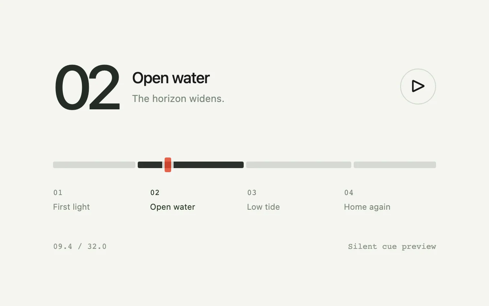

# Cue scrubber

> A segmented timeline makes meaningful chapter boundaries visible and directly seekable.

- **Common name:** Chapter timeline scrubber
- **Category:** Components & interactions
- **Live demo:** https://www.subframe.com/motion/cue-scrubber
- **Source:** Subframe (original, MIT)
- **Dependencies:** none

## Use case

Jump to a meaningful moment without scanning an entire recording.

## Interaction

Preview a cue on hover, jump to a chapter or scrub the clock.

## Look

Off-white page with a giant dark chapter numeral and title, a segmented grey timeline with one dark segment and red handle, and small chapter labels.

## Motion

Play runs a frame-driven 32 s clock that carries the red handle across four chapter segments, darkening the current one; hovering the track floats a chapter-and-time label.

## How to adapt

Playback is the `tick` loop in a `requestAnimationFrame` effect writing `clock` and `time`; `seek` jumps, and segment widths derive from `CUES` and `DURATION`. Replace `CUES` with your chapters and drive `time` from a real media element's current time.

## Reduced motion

Clock updates remain functional; no eased marker travel or scene transition.

## Limitations

A silent 32-second chapter timeline; no video or external media.

## Taxonomy

- **Components:** media, slider
- **Triggers:** drag, hover, press
- **Techniques:** slide
- **Feel:** technical, subtle
- **Contexts:** app, editorial
- **Tags:** timeline, chapter, cue, scrub, seek, transport
- **Also known as:** video chapter markers, segmented seek bar, timeline hover preview, chapter navigation
- **Surface color:** `#f4f5f1`

## Code

See [`component.tsx`](component.tsx).
