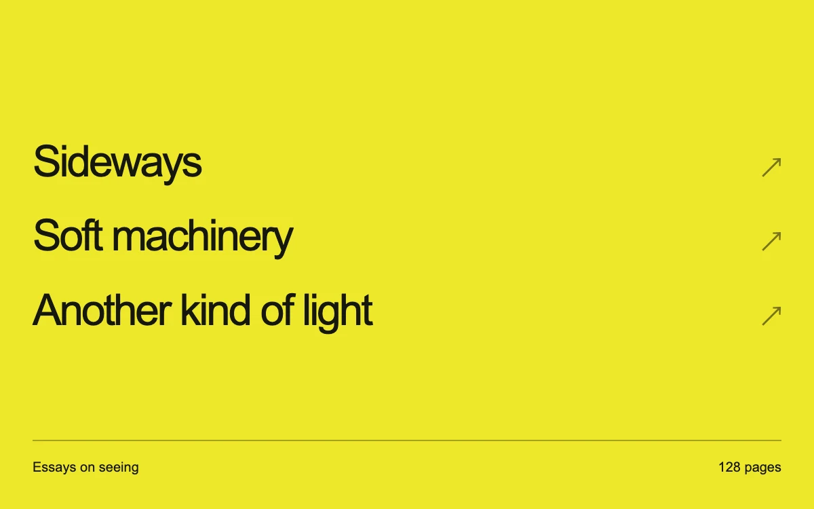

# Cursor adapter

> A small ink cursor stretches into the exact width of a title in a sharp yellow publishing index.

- **Common name:** Morphing custom cursor
- **Category:** Components & interactions
- **Live demo:** https://www.subframe.com/motion/cursor-adapter
- **Source:** Subframe (original, MIT)
- **Dependencies:** none

## Use case

Give editorial links a scoped pointer treatment that identifies the actual actionable text.

## Interaction

Move across titles and choose a book.

## Look

Saturated lemon-yellow page with a stacked list of large black sans-serif titles, faint arrow glyphs at right, and a thin ruled footer.

## Motion

A small black ink bar trails the mouse with exponential smoothing, shedding fading dots; over a title it glides beneath the text and stretches to the title's exact width.

## How to adapt

The cursor is painted on the overlay `canvas` in `paint`: `head` eases toward `target` (the hovered `button[data-book]` span) with `1 - Math.exp(-dt / 65)`, and `trail` dots last 230 ms. Replace `titles` and footer copy; tag other targets with `data-book`.

## Reduced motion

The native cursor and focus states remain; the auxiliary cursor and trail are disabled.

## Limitations

The custom pointer enhancement is mouse-only and scoped to this component. Native controls remain usable on touch.

## Taxonomy

- **Components:** cursor, list
- **Triggers:** pointer, hover
- **Techniques:** canvas, morph
- **Feel:** refined, subtle
- **Contexts:** editorial, landing
- **Tags:** cursor, hover, context, editorial, canvas
- **Also known as:** cursor snaps to link, hover underline cursor, magnetic link cursor, contextual cursor
- **Surface color:** `#eee72b`

## Code

See [`component.tsx`](component.tsx).
