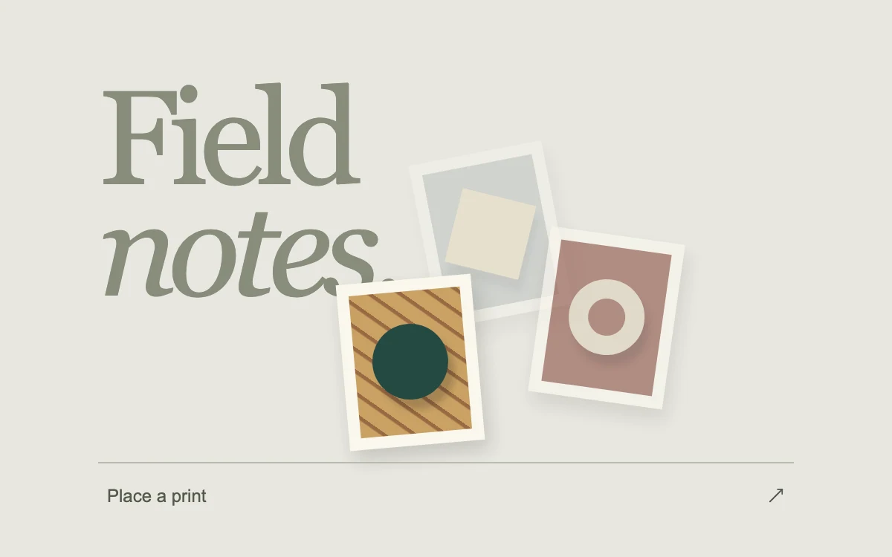

# Loose impressions

> A trail of small relief prints follows movement through an exhibition field with three prints visible at rest.

- **Common name:** Cursor image trail
- **Category:** Animation & motion
- **Live demo:** https://www.subframe.com/motion/cursor-exhibition
- **Source:** Subframe (original, MIT)
- **Dependencies:** none

## Use case

Let a portfolio reveal a visual collection through exploration without taking over the page.

## Interaction

Move through the field or place a print

## Look

Warm stone-grey page with a large muted olive serif headline, tilted cream-matted abstract prints with soft shadows, and a thin-ruled text button along the bottom.

## Motion

Mouse movement drops a tilted print after every 7% of travel; each pops in from 0.85 scale over 300 ms ease-out, older prints fade, and six remain at most.

## How to adapt

`place` adds a print when the pointer moves 7% from `last`, keeps six via `slice(-5)` and derives each `angle` from its `id`; entry is the `sf-impression-in` keyframes. Replace the `.impression` CSS artwork with real images and rewrite the `.word` headline.

## Reduced motion

Live reduced-motion preferences remove interpolation and decorative playback. All content and native controls remain available. Keyboard changes settle immediately.

## Limitations

Original demonstration content; adapt labels and state to the host product.

## Taxonomy

- **Components:** cursor, gallery
- **Triggers:** pointer, press
- **Techniques:** scale, fade
- **Feel:** playful, refined
- **Contexts:** editorial, landing
- **Tags:** cursor, trail, art, portfolio, pointer
- **Also known as:** mouse trail images, image trail on hover, cursor follow photos, portfolio hover trail, pointer print trail
- **Surface color:** `#e9e7e1`

## Code

See [`component.tsx`](component.tsx).
