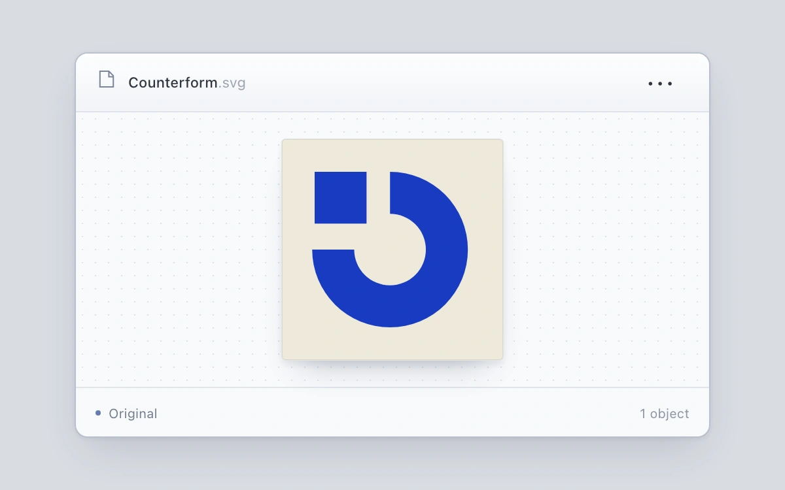

# Artwork context menu

> A bounded context menu rotates, inverts and duplicates the artwork it belongs to.

- **Common name:** Right-click context menu
- **Category:** Components & interactions
- **Live demo:** https://www.subframe.com/motion/cursor-menu
- **Source:** Subframe (original, MIT)
- **Dependencies:** none

## Use case

Provide local commands whose consequences are visible on the selected asset.

## Interaction

Right-click or tap an artwork, use the three-dot button, or press Shift+F10. Rotate, invert ink or duplicate; each copy remains independently editable.

## Look

Cool grey page with a pale file window whose dotted artboard holds a cream square printed with bold cobalt geometric shapes.

## Motion

Clicking or right-clicking the artwork opens a menu at the pointer that fades and scales up from 0.97 in 150 ms; rotation eases 90° in 280 ms, copies slide in.

## How to adapt

The menu is placed by `open`, which maps pointer coordinates into the 600-unit stage and clamps them, and animates with `sf-context-menu` (150 ms); rotation is the `Stamp` transform with a 280 ms transition. Replace `Stamp` and the three `menuitem` actions with your own.

## Reduced motion

Finite transitions become immediate under reduced motion and keyboard input. Host pause disables controls; any owned drag is cancelled.

## Limitations

Original SVG artwork and at most two local objects; no filesystem writes or clipboard actions. Rotation and ink inversion apply to the selected object only.

## Taxonomy

- **Components:** menu
- **Triggers:** press, keyboard
- **Techniques:** scale, fade, rotate
- **Feel:** subtle
- **Contexts:** app
- **Tags:** context-menu, artwork, pointer-origin, roving-focus, duplicate, rotate, invert, keyboard, bounds
- **Also known as:** popup actions menu, overflow menu, kebab menu, shortcut menu, asset actions menu
- **Surface color:** `#d9dce2`

## Code

See [`component.tsx`](component.tsx).
