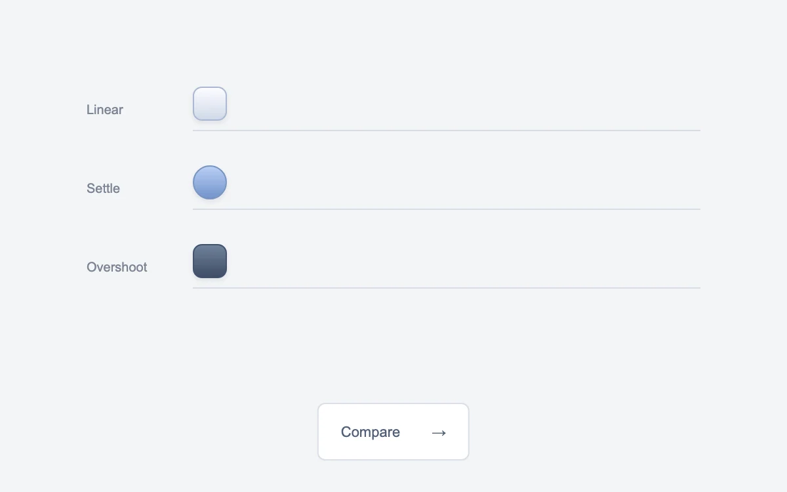

# Three ways to arrive

> Three identical objects traverse equal distances with distinctly different timing.

- **Common name:** Easing curves comparison
- **Category:** Animation & motion
- **Live demo:** https://www.subframe.com/motion/curve-lab
- **Source:** Subframe (original, MIT)
- **Dependencies:** none

## Use case

Compare the feel of an easing choice before applying it to a real interaction.

## Interaction

Send the objects across

## Look

Pale cool-grey page with three labelled rails, each starting with a small gradient token (light square, blue circle, slate square), and a white button below.

## Motion

Pressing the button slides all three tokens across their rails together in 900 ms, one linear, one ease-out settle and one cubic-bezier overshoot; pressing again returns them.

## How to adapt

Each `runner` transitions `transform` over 900ms with its timing from the `curves` array (`linear`, `cubic-bezier(.2,.8,.2,1)`, `cubic-bezier(.2,1.45,.3,1)`); edit those strings to compare your own easings. Labels and token styles are demo content; keep the `data-still` override.

## Reduced motion

Live reduced-motion preferences remove interpolation and decorative playback. All content and native controls remain available. Keyboard changes settle immediately.

## Limitations

Original demonstration content; adapt labels and state to the host product.

## Taxonomy

- **Components:** editor
- **Triggers:** press
- **Techniques:** slide, spring
- **Feel:** technical, subtle
- **Contexts:** editorial, app
- **Tags:** easing, timing, comparison, motion study, curves
- **Also known as:** timing function demo, ease-out vs linear, cubic-bezier preview, overshoot easing, motion curve study
- **Surface color:** `#f3f4f6`

## Code

See [`component.tsx`](component.tsx).
