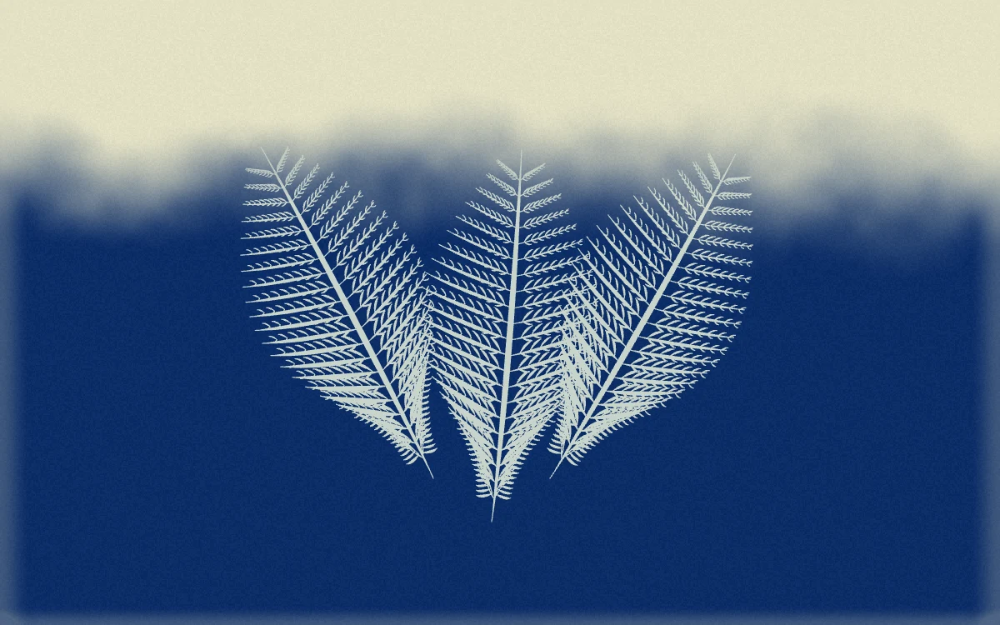

# Cyanotype bloom

> A branching botanical contact print develops from pale paper into deep cobalt as exposure increases.

- **Common name:** Growing botanical shader
- **Category:** WebGL & shaders
- **Live demo:** https://www.subframe.com/motion/cyanotype-bloom
- **Source:** Subframe (original, MIT)
- **Dependencies:** none

## Use case

Explore a direct material-development reveal for print, photography and generative artwork.

## Interaction

Develop the print with the exposure slider

## Look

Grainy cream paper giving way to deep cobalt blue along a soft ragged edge, with three pale fern fronds fanned at centre.

## Motion

Moving the exposure slider raises a noise-edged development front from bottom to top, turning paper to cobalt, while a gradient mask reveals the fern silhouettes upward; no autonomous loop.

## How to adapt

The paper-to-blue front is `wet` in `FRAGMENT`, driven by `u_control`; fern fronds come from `specimenPath` via `SPECIMENS`, revealed by the `${maskId}-development` gradient mask and `Math.pow(control, 0.38)` opacity. Swap `SPECIMENS` for your own SVG paths and tune `paper` and `blue`.

## Reduced motion

There is no autonomous animation loop. Exposure directly redraws the paper field and botanical reveal.

## Limitations

Stylized exposure preview, not a photographic chemistry simulation. Original vector specimens over a native WebGL1 paper field; remount after context loss.

## Taxonomy

- **Components:** image, background
- **Triggers:** state, drag
- **Techniques:** shader, mask, noise
- **Feel:** calm, refined
- **Contexts:** editorial, landing
- **Tags:** cyanotype, botanical, contact print, exposure, development, grain, native webgl, svg
- **Also known as:** sun print effect, photo development reveal, exposure slider reveal, fern silhouette reveal
- **Surface color:** `#143b79`

## Code

See [`component.tsx`](component.tsx).
