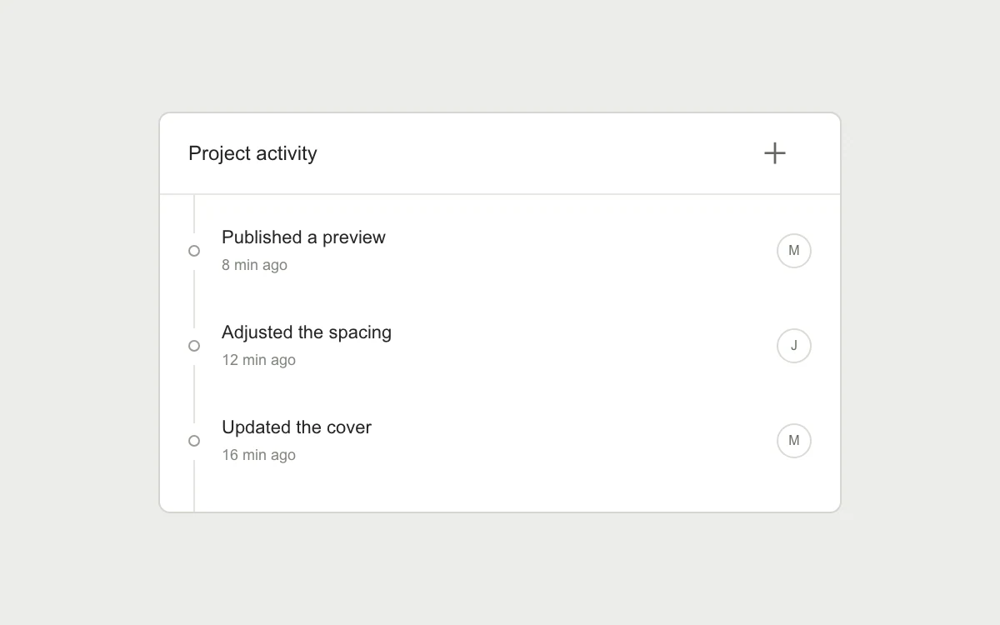

# Deferred feed

> New activity waits behind a compact unread indicator while the current reading position stays put.

- **Common name:** Unread updates feed
- **Category:** Components & interactions
- **Live demo:** https://www.subframe.com/motion/deferred-feed
- **Source:** Subframe (original, MIT)
- **Dependencies:** none

## Use case

Accept live updates without pushing the content someone is reading out of view.

## Interaction

Add a preview update, keep reading, or jump to the newest entry.

## Look

Light warm-grey page with a white bordered activity card: plus-button header, timeline dots on a thin line, grey timestamps and circled initials.

## Motion

Adding an update while scrolled down prepends it without shifting visible rows and fades a blue unread pill down 5 px over 180 ms; pressing it smooth-scrolls to the top.

## How to adapt

Scroll anchoring is manual: `add` records the distance from the bottom in `offset` and a `useLayoutEffect` restores it after the prepend, with `overflow-anchor:none` set; `jump` clears `unread`. Replace `labels` with real activity; the pill entrance is the `feed-w2` keyframes.

## Reduced motion

Jump to newest scrolls immediately; unread counts and anchor preservation remain active.

## Limitations

Four manually triggered local updates; no realtime backend.

## Taxonomy

- **Components:** list, notification
- **Triggers:** state, scroll, press
- **Techniques:** fade, slide
- **Feel:** subtle
- **Contexts:** app, dashboard
- **Tags:** feed, unread, scroll-anchor, prepend, notifications, backlog, scroll
- **Also known as:** new posts pill, scroll anchoring feed, live activity feed, jump to latest button, new items indicator
- **Surface color:** `#ededeb`

## Code

See [`component.tsx`](component.tsx).
