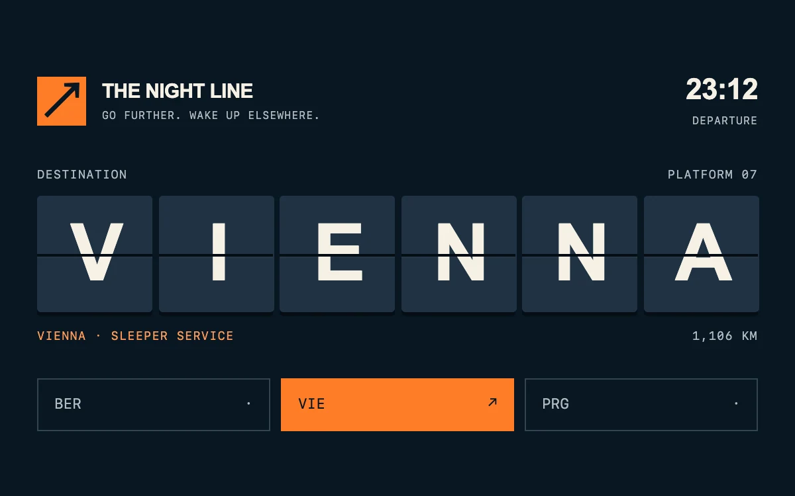

# The night line

> A mechanical destination board turns a practical selection into a small moment of departure.

- **Common name:** Split-flap departure board
- **Category:** Animation & motion
- **Live demo:** https://www.subframe.com/motion/departure-board
- **Source:** Subframe (original, MIT)
- **Dependencies:** none

## Use case

Give travel, event schedules or destination choices a tactile identity while keeping the selected information readable.

## Interaction

Choose a destination

## Look

Dark navy board with six slate letter tiles split by a black seam, cream heavy capitals, orange accent square and active button, and monospace labels.

## Motion

Choosing a destination turns each letter tile over on its horizontal axis from the old letter to the new, 440 ms with ease-in-out, staggered 45 ms left to right.

## How to adapt

Each `sf-departures-leaf` carries the previous and next letter on `sf-departures-front`/`sf-departures-back` and runs `sf-departures-turn` (440 ms) with a per-cell `animationDelay`; remounting on `selection.sequence` replays it. Replace `services`; the grid assumes six-letter names.

## Reduced motion

The destination updates immediately without rotation. Keyboard selections are also immediate.

## Limitations

A stylized single hinged tile turn, not an alphabet-by-alphabet physical simulation. Departure times and distances are fictional demonstration content.

## Taxonomy

- **Components:** text, picker
- **Triggers:** press, state
- **Techniques:** rotate, 3d, stagger, split-text
- **Feel:** refined, bold
- **Contexts:** landing, app
- **Tags:** departure, travel, split flap, flip, mechanical, destination, schedule, CSS 3D, state change
- **Also known as:** flip board text, split flap display, airport board animation, flipping letter tiles
- **Surface color:** `#091622`

## Code

See [`component.tsx`](component.tsx).
