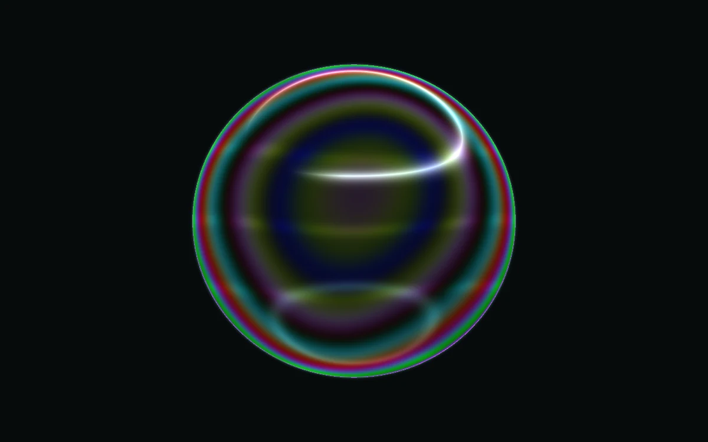

# Dichroic film

> A thin translucent membrane rolls through olive, cobalt, and rose interference.

- **Common name:** Iridescent film shader
- **Category:** WebGL & shaders
- **Live demo:** https://www.subframe.com/motion/dichroic-film
- **Source:** Subframe (original, MIT)
- **Dependencies:** none

## Use case

Give packaging, cosmetics, and experimental identities a distinctive thin-film finish.

## Interaction

Adjust thickness

## Look

Glossy iridescent sphere banded with teal, magenta, olive and deep blue rings, a white softbox highlight and thin green rim on near-black.

## Motion

Interference bands slowly roll across the bubble as a sine term in the film thickness advances with time; a thickness slider shifts the whole colour sequence.

## How to adapt

All colour comes from the `FRAGMENT` shader: `thickness` drives the cosine `interference` palette (`vec3(17.0,22.0,29.0)` sets hue spacing), `u_time*.12` sets drift speed, and `radius` sizes the sphere. Keep the WebGL lifecycle and reduced-motion branch.

## Reduced motion

A representative frame remains still. Live system preference changes immediately stop the loop; the range control continues to update the still image.

## Limitations

Requires WebGL 1. A static CSS fallback appears when unavailable or after context loss. An authored thin-film palette model, not measured spectral material data.

## Taxonomy

- **Components:** scene, background
- **Triggers:** ambient
- **Techniques:** shader, gradient, glow
- **Feel:** calm, refined
- **Contexts:** landing, editorial
- **Tags:** iridescent, thin film, soap, interference, membrane, native webgl
- **Also known as:** soap bubble shader, iridescent sphere, holographic orb, thin-film interference, oil slick bubble
- **Surface color:** `#20242b`

## Code

See [`component.tsx`](component.tsx).
