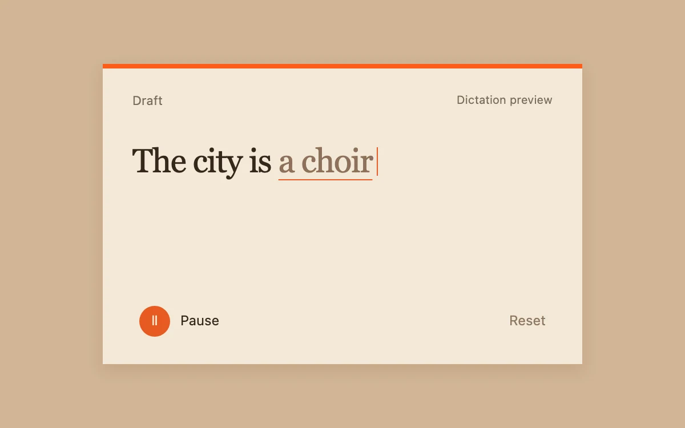

# Dictation draft

> Provisional words revise themselves before settling into an editable serif draft.

- **Common name:** Live dictation transcript
- **Category:** Components & interactions
- **Live demo:** https://www.subframe.com/motion/dictation-draft
- **Source:** Subframe (original, MIT)
- **Dependencies:** none

## Use case

Avoid treating unconfirmed speech recognition as final text.

## Interaction

Preview, pause and reset the incoming words, then edit the finished draft.

## Look

Tan background, a cream note card with an orange top rule, large dark serif text ending in muted underlined words, and a round orange button.

## Motion

Pressing Preview steps through scripted frames every 850 ms: provisional words, underlined with a blinking caret, revise and settle into dark final text, which then becomes an editable textarea.

## How to adapt

A `requestAnimationFrame` clock in the effect advances `step` through `FRAMES` (final and partial text pairs) every 850 ms; the caret blink is `sf-dictate-caret`. Feed final and partial strings from your speech-recognition events instead, keeping the `textarea` handoff.

## Reduced motion

The caret stops blinking; discrete text updates and draft editing remain available.

## Limitations

Scripted partial and final transcription. No microphone or speech-recognition service.

## Taxonomy

- **Components:** text, input
- **Triggers:** press, state
- **Techniques:** loop
- **Feel:** subtle, calm
- **Contexts:** app
- **Tags:** dictation, transcript, stream, text, draft, input
- **Also known as:** speech to text, live transcription, voice typing, streaming transcript, interim speech results
- **Surface color:** `#d1b595`

## Code

See [`component.tsx`](component.tsx).
