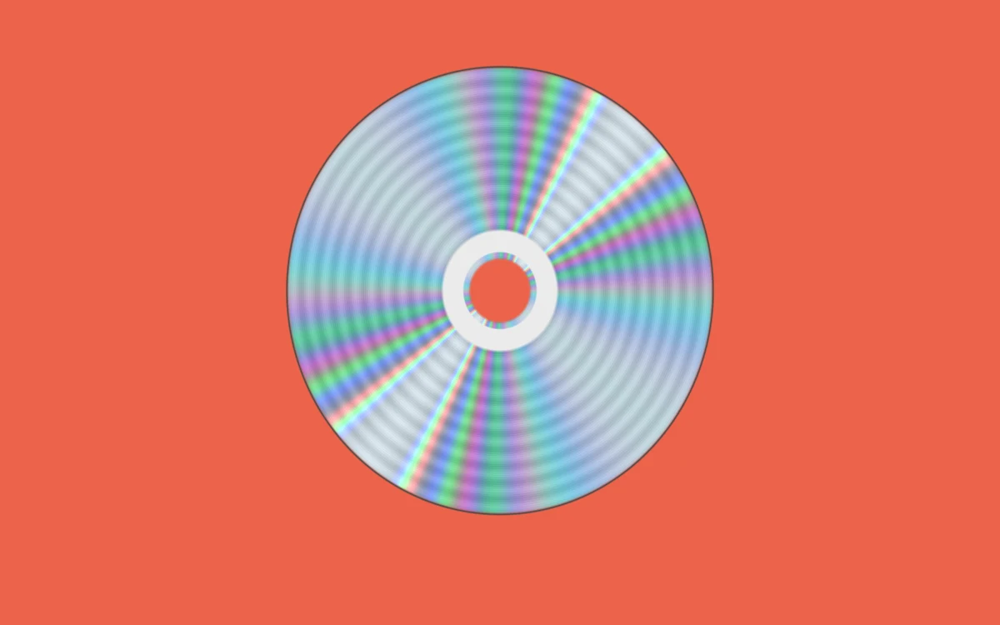

# Diffraction disc

> A silver disc sends narrow spectral reflections across its fine concentric tracks.

- **Common name:** Iridescent CD shader
- **Category:** WebGL & shaders
- **Live demo:** https://www.subframe.com/motion/diffraction-disc
- **Source:** Subframe (original, MIT)
- **Dependencies:** none

## Use case

Use tangent-directed diffraction as a controllable optical material.

## Interaction

Adjust track spacing.

## Look

Flat coral-red field with a centred silver compact disc whose fine concentric grooves carry radiating rainbow bands of cyan, green, magenta and pale blue.

## Motion

The light angle rocks ±18° on a 29 s sine, swinging the rainbow bands and specular streak across the disc; the track-spacing slider packs more or fewer bands around it.

## How to adapt

All of it is the `FRAGMENT` shader: `theta` swings the light (`u_time*.22`), `u_control` scales dispersion, `wavelength` maps each of six orders to RGB, and `sin(r*1800.)` draws the grooves. Change `bg` with the container background; keep the context-loss and reduced-motion handling.

## Reduced motion

The elapsed-time clock stops. Parameter controls immediately update the static composition.

## Limitations

Requires WebGL 1; a static CSS swatch appears if unavailable or after context loss. Six approximate spectral orders and authored RGB wavelength response, not a measured optical coating.

## Taxonomy

- **Components:** background, scene
- **Triggers:** ambient, state
- **Techniques:** shader, gradient, glow
- **Feel:** refined, calm
- **Contexts:** landing, editorial
- **Tags:** native webgl, diffraction, grating, spectral, disc, optical
- **Also known as:** holographic disc effect, rainbow foil reflection, compact disc shimmer, diffraction grating shader
- **Surface color:** `#ed674f`

## Code

See [`component.tsx`](component.tsx).
