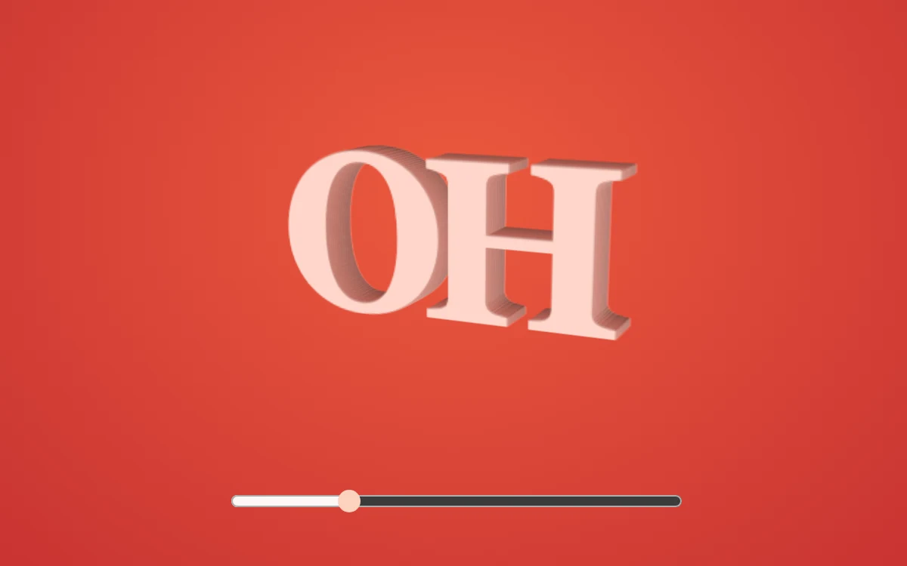

# Cast type

> A solid typographic object turns to show its extruded edges.

- **Common name:** 3D extruded text
- **Category:** Animation & motion
- **Live demo:** https://www.subframe.com/motion/dimensional-type
- **Source:** Subframe (original, MIT)
- **Dependencies:** none

## Use case

Give a wordmark dimensional weight without downloading a model or font.

## Interaction

Turn the wordmark

## Look

Heavy pale-pink serif letters with deep, darker extruded sides float over a saturated coral-red radial gradient, with a single slider below.

## Motion

Dragging the slider turns the wordmark around its vertical axis between -48° and 48° with a 0.2 s ease-out, revealing 18 stacked layers as extruded edges.

## How to adapt

Depth is 18 stacked `b` copies inside `cast`, each offset by `translateZ` and darkened via `hsl`; the turn is `rotateY` on `object` with a 0.2 s ease-out transition driven by `angle`. Replace the `OH` wordmark, font and colours; keep the `data-still` reduced-motion switch.

## Reduced motion

Live reduced-motion preferences remove interpolation and decorative playback. All content and native controls remain available. Keyboard changes settle immediately.

## Limitations

Original demonstration content; adapt labels and state to the host product.

## Taxonomy

- **Components:** text
- **Triggers:** drag, keyboard
- **Techniques:** 3d, rotate
- **Feel:** bold
- **Contexts:** landing, editorial
- **Tags:** typography, 3D, extrusion, rotation, wordmark
- **Also known as:** CSS 3D text, layered text extrusion, rotating 3D wordmark, text depth effect
- **Surface color:** `#e4473c`

## Code

See [`component.tsx`](component.tsx).
