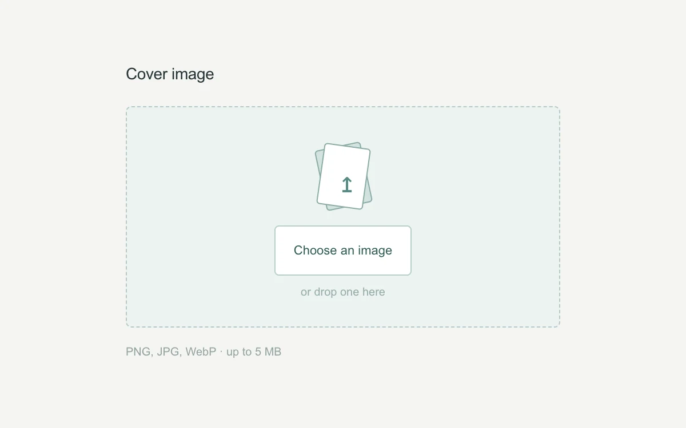

# Dropzone preview

> A compact import well opens into an actual local image preview.

- **Common name:** File drop zone with preview
- **Category:** Components & interactions
- **Live demo:** https://www.subframe.com/motion/dropzone-preview
- **Source:** Subframe (original, MIT)
- **Dependencies:** none

## Use case

Confirm an image selection and expose useful errors before any upload.

## Interaction

Drop a PNG, JPG or WebP, or choose one; replace or remove it.

## Look

Warm off-white page with a pale grey-green dashed drop well, a small two-card upload illustration, a white outlined button and grey helper text.

## Motion

Dragging a file over the well turns its dashed border solid teal and deepens the fill as the front paper straightens and the back one tilts away over 200 ms.

## How to adapt

Drag emphasis is CSS keyed on `[data-drag=true]` (`.well` colours, `.papers i` and `.papers b` rotations), toggled with a `depth` counter; `take` validates type and size and creates the object URL. Replace the MIME list, size limit and copy, then add your upload.

## Reduced motion

Drop emphasis and illustration settle immediately; local selection and decoding remain functional.

## Limitations

Local preview only; accepts raster MIME types up to 5 MB and does not upload or persist files.

## Taxonomy

- **Components:** picker, input
- **Triggers:** drag, press
- **Techniques:** rotate
- **Feel:** subtle
- **Contexts:** app
- **Tags:** file, drag-drop, image, preview, validation, object-url, upload, admission
- **Also known as:** drag and drop upload, image upload field, file uploader, drop target highlight
- **Surface color:** `#f5f5f3`

## Code

See [`component.tsx`](component.tsx).
