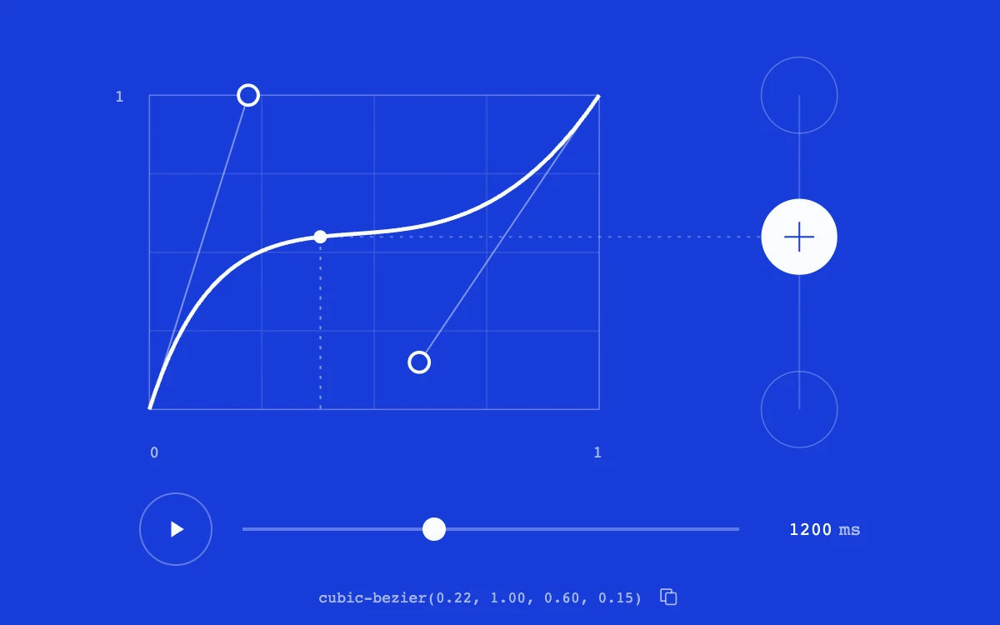

# Easing workbench

> Two editable curve handles connect time to a moving white marker on a cobalt timing instrument.

- **Common name:** Cubic bezier easing editor
- **Category:** Animation & motion
- **Live demo:** https://www.subframe.com/motion/easing-workbench
- **Source:** Subframe (original, MIT)
- **Dependencies:** none

## Use case

Authoring and inspecting CSS timing curves with a synchronized, seekable motion preview.

## Interaction

Drag the handles, scrub time, play the motion, or copy the CSS curve

## Look

Cobalt-blue panel with a white bezier curve on a faint grid, hollow white handles, a side track with a large white marker and monospace controls.

## Motion

Play runs time linearly over the duration (1200 ms default) while a bead rides the curve and a side marker tracks the eased value; handle drags reshape it live.

## How to adapt

`valueAtTime` solves the curve by bisection on x and `screenPoint` maps 0–1 values into the graph; `tick` advances `progressRef` by elapsed time over `duration`. Change the `START` handles and feed `curve` (the CSS string) to your own animation.

## Reduced motion

Playback becomes explicit quarter-step advancement; manual scrubbing and curve editing remain available.

## Limitations

Both control-point coordinates are bounded to 0–1. It covers CSS cubic timing curves without overshoot; not a spring simulator.

## Taxonomy

- **Components:** editor, slider
- **Triggers:** drag, press
- **Techniques:** path, slide
- **Feel:** technical
- **Contexts:** app
- **Tags:** easing, bezier, curve, timing, editor, scrub, svg
- **Also known as:** easing curve playground, timing function editor, cubic-bezier generator, animation curve tool
- **Surface color:** `#183cd8`

## Code

See [`component.tsx`](component.tsx).
