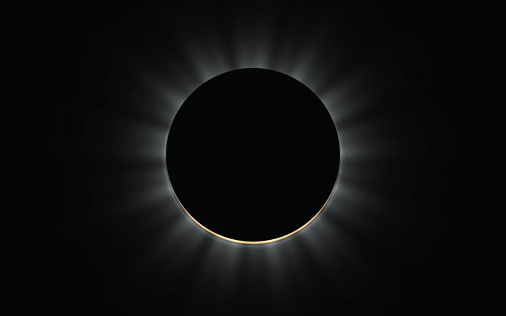

# Eclipse corona

> A dark lunar disk reveals a fine white corona and a warm crescent.

- **Common name:** Eclipse glow shader
- **Category:** WebGL & shaders
- **Live demo:** https://www.subframe.com/motion/eclipse-corona
- **Source:** Subframe (original, MIT)
- **Dependencies:** none

## Use case

A restrained celestial focal point for observatories, festivals, and launch moments.

## Interaction

Adjust alignment

## Look

Near-black field with a centred black lunar disc ringed by soft white radial corona streaks and a thin warm-gold crescent along its lower edge.

## Motion

Corona rays drift very slowly around the rim and the moon bobs slightly on a roughly 70 s sine; the alignment slider slides the moon sideways, moving the crescent.

## How to adapt

The `FRAGMENT` shader holds everything: `rays` sets corona streak count and drift, `corona` its falloff, and `shift` the moon offset driven by `u_control`. Recolour the crescent via `vec3(1.0,.67,.32)`; keep the context-loss and reduced-motion handling.

## Reduced motion

A representative frame remains still. Live system preference changes immediately stop the loop; the range control continues to update the still image.

## Limitations

Requires WebGL 1. A static CSS fallback appears when unavailable or after context loss. An astronomical illustration, not an ephemeris or physically accurate solar-atmosphere model.

## Taxonomy

- **Components:** background, scene
- **Triggers:** ambient, state
- **Techniques:** shader, glow
- **Feel:** calm, refined
- **Contexts:** landing, editorial
- **Tags:** eclipse, corona, occlusion, celestial, astronomy, native webgl
- **Also known as:** solar eclipse animation, corona glow background, dark hero light ring, eclipse hero visual
- **Surface color:** `#111317`

## Code

See [`component.tsx`](component.tsx).
