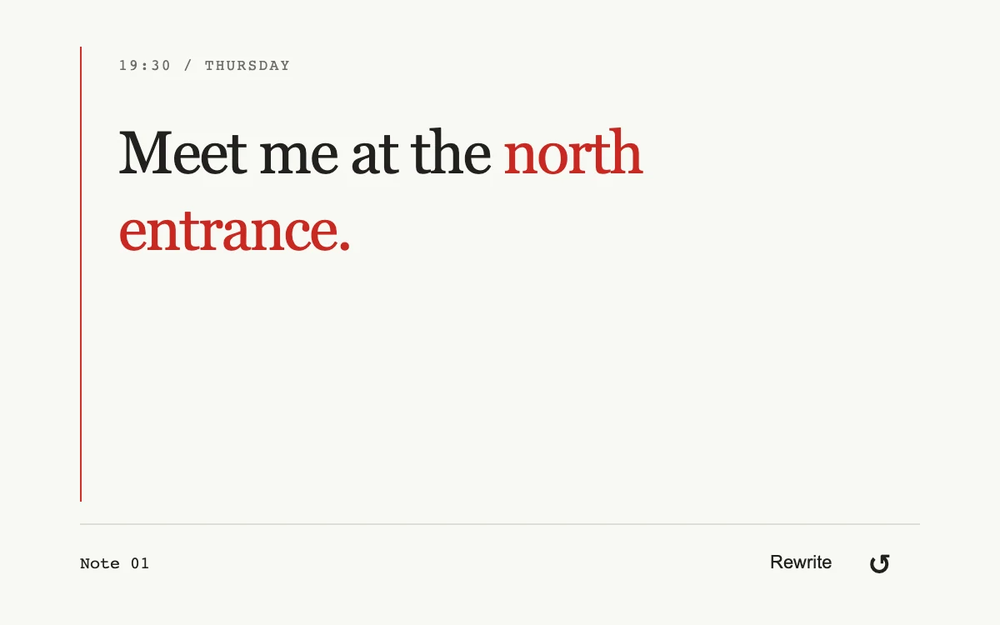

# Editing caret

> A short note types, pauses and corrects one detail with a caret attached to the actual string.

- **Common name:** Typewriter text effect
- **Category:** Animation & motion
- **Live demo:** https://www.subframe.com/motion/editing-caret
- **Source:** Subframe (original, MIT)
- **Dependencies:** none

## Use case

Make a deliberate textual revision visible as a finite sequence.

## Interaction

Rewrite the note.

## Look

Warm off-white page with a large dark serif note, its corrected phrase in red, a thin red left margin rule and small monospace labels.

## Motion

On press, the note types character by character (46–85 ms each) with a red caret, holds 850 ms, backspaces past the wrong word, then retypes the ending in red.

## How to adapt

The sequence is precomputed into `script` (each step a `text` snapshot with an `ms` delay and `revision` flag) and stepped by the `requestAnimationFrame` `tick`. Set `prefix`, `oldWord`, `newWord`, `suffix` and the `ec-sr` copy for your sentence; tune the `ms` formulas.

## Reduced motion

The complete corrected note is shown immediately; no typing or blinking loop.

## Limitations

A fixed editorial sentence and timing sequence, not an editable rich-text engine or streaming transport.

## Taxonomy

- **Components:** text
- **Triggers:** press
- **Techniques:** split-text
- **Feel:** refined
- **Contexts:** editorial, landing
- **Tags:** typewriter, caret, character, backspace, revision, finite
- **Also known as:** typing animation, backspace and retype, text correction effect, typed revision
- **Surface color:** `#f7f7f3`

## Code

See [`component.tsx`](component.tsx).
