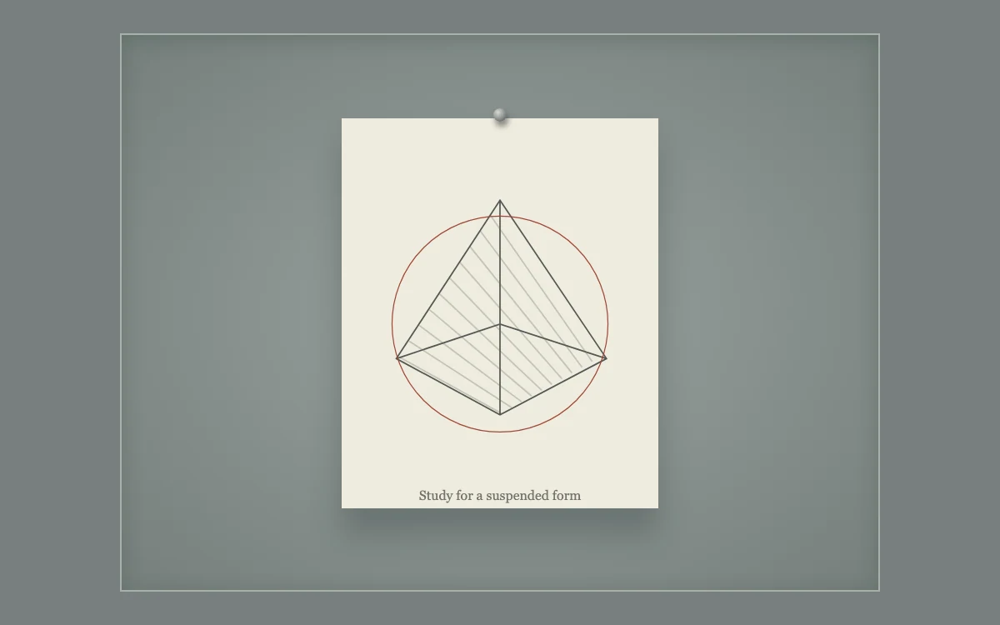

# Pinned study

> A suspended drawing moves within its frame and settles back into place.

- **Common name:** Springy draggable card
- **Category:** Animation & motion
- **Live demo:** https://www.subframe.com/motion/elastic-artboard
- **Source:** Subframe (original, MIT)
- **Dependencies:** none

## Use case

Give a movable preview a clear resting position and physical resistance.

## Interaction

Drag the study or nudge it with arrow keys

## Look

Muted grey-green framed mat with one pinned cream sheet showing a fine geometric line drawing inside a thin red circle.

## Motion

Dragging moves the sheet at 0.65× pointer speed within a small clamp, tilting slightly with horizontal offset; release returns it to rest over 650 ms on an overshooting cubic-bezier.

## How to adapt

Pointer handlers on the `drawing` button set `position`, clamped to ±45 by ±30 px with a `position.x * 0.06` degree tilt; `end` resets it, and the `drawing` CSS transition `cubic-bezier(.2,1.35,.3,1)` supplies the overshoot. Replace the SVG study and caption.

## Reduced motion

Live reduced-motion preferences remove interpolation and decorative playback. All content and native controls remain available. Keyboard changes settle immediately.

## Limitations

Original demonstration content; adapt labels and state to the host product.

## Taxonomy

- **Components:** card
- **Triggers:** drag
- **Techniques:** spring, rotate
- **Feel:** playful, refined
- **Contexts:** editorial, app
- **Tags:** drag, spring, constraints, artboard, pointer capture
- **Also known as:** rubber band drag, snap-back drag, elastic drag constraints, return to origin drag
- **Surface color:** `#777f7f`

## Code

See [`component.tsx`](component.tsx).
