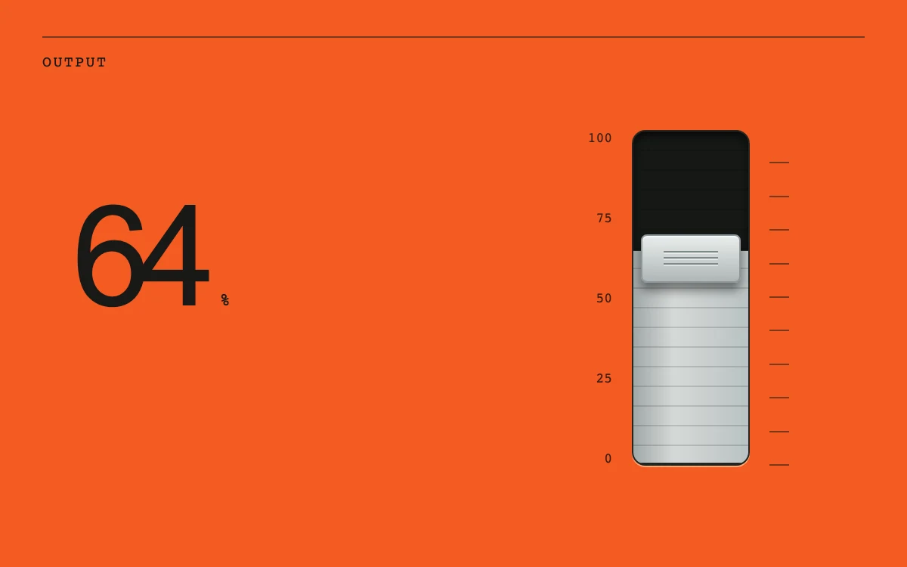

# Elastic fader

> An orange level control stretches against its limits and settles back around a brushed-metal fill.

- **Common name:** Elastic slider
- **Category:** Components & interactions
- **Live demo:** https://www.subframe.com/motion/elastic-fader
- **Source:** Subframe (original, MIT)
- **Dependencies:** none

## Use case

Bounded continuous input with tactile overtravel.

## Interaction

Drag the level past either endpoint, or use arrow keys.

## Look

Saturated orange panel with an oversized black level number, monospace scale labels and a vertical black fader track holding a brushed-metal fill and silver cap.

## Motion

Dragging sets the level directly; pulling past either end stretches the track with logarithmic resistance up to 26%, and on release it springs back with a 380 ms overshooting cubic-bezier.

## How to adapt

Overtravel is computed in `update`: values beyond 0–100 become a `Math.log1p` stretch times `0.045`, capped at `0.26` and applied as `scaleY` on `.sf-ef-shell` from `stretchOrigin`. Tune the `380ms cubic-bezier(.18,1.5,.35,1)` return; wire `value` to your setting.

## Reduced motion

The level changes immediately; shell deformation is removed.

## Limitations

A local 0–100 level, not an audio mixer.

## Taxonomy

- **Components:** slider
- **Triggers:** drag, keyboard
- **Techniques:** spring, scale
- **Feel:** playful, technical
- **Contexts:** app
- **Tags:** fader, elastic, rubber-band, overscroll, level, drag, hardware
- **Also known as:** rubber band slider, overscroll slider, vertical volume fader, stretchy range input, mixer fader
- **Surface color:** `#f35b22`

## Code

See [`component.tsx`](component.tsx).
