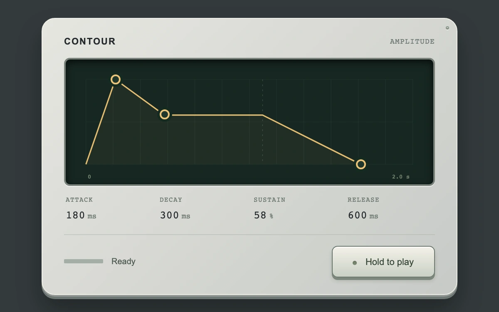

# Give the note its shape

> Three draggable breakpoints author attack, decay, sustain and release for a held synthesized note.

- **Common name:** ADSR envelope editor
- **Category:** Components & interactions
- **Live demo:** https://www.subframe.com/motion/envelope-shaper
- **Source:** Subframe (original, MIT)
- **Dependencies:** none

## Use case

Connect an editable amplitude curve to the audible lifecycle of a synthesizer or sound-design instrument.

## Interaction

Drag envelope nodes, then hold the play key to hear the result. Arrows adjust times; up/down on the decay node changes sustain. Releasing the key starts the release ramp.

## Look

Pale aluminum instrument housing, a recessed dark-green display, fine amber envelope line and a tactile hold-to-play key.

## Motion

The curve reshapes directly under three handles. Audio follows attack and decay into held sustain; release continues from the actual current amplitude, including release during attack. A cursor and meter track playback.

## How to adapt

`envelopeGain` computes the linear held-note amplitude; `release` cancels future ramps and schedules from that current value. `INITIAL` sets the starting envelope. `DEFAULT_CONFIG` and the `config` prop control display time, pitch, segment floor and cursor.

## Reduced motion

The authored curve stays static while editing. Reduced motion removes the playback cursor and live meter motion, retaining the stage label. Host pause, hidden document and unmount dispose audio.

## Limitations

One native triangle oscillator with a modest fixed peak gain, linear envelope stages and no MIDI. Browser audio permission and output availability apply. The sustain span is a schematic 0.6 seconds; the actual note holds for as long as the key is held. Changes affect the next note.

## Taxonomy

- **Components:** editor, media, slider, button
- **Triggers:** drag, press, keyboard, state
- **Techniques:** path, slide
- **Feel:** refined, technical
- **Contexts:** app, dashboard
- **Tags:** audio, ADSR, envelope, synthesizer, attack, decay, sustain, release, Web Audio, curve
- **Also known as:** amplitude envelope, sound envelope, direct ADSR editing, held note, synth envelope
- **Surface color:** `#333a3c`

## Code

See [`component.tsx`](component.tsx).
