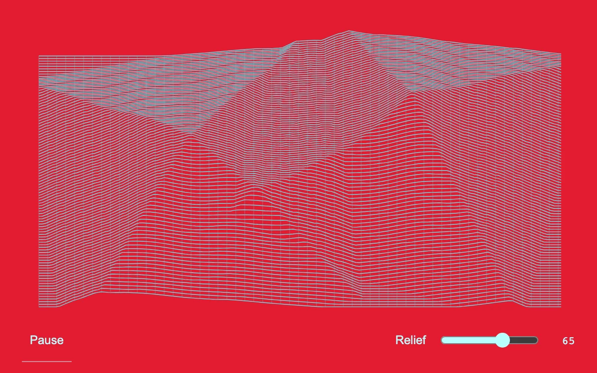

# Etched terraces

> Fine cyan scanlines bend over two stepped reliefs on a saturated red field.

- **Common name:** Generative scanline art
- **Category:** Animation & motion
- **Live demo:** https://www.subframe.com/motion/etched-terraces
- **Source:** Subframe (original, MIT)
- **Dependencies:** none

## Use case

Generative architectural textures, art direction, and dimensional line artwork.

## Interaction

Adjust relief and pause the moving engraving

## Look

Saturated red field with a dense mesh of thin cyan scanlines and faint verticals lifted over two stepped pyramidal reliefs, minimal cyan controls below.

## Motion

Two stepped square reliefs rock slowly in rotation under a mesh of scanlines, with a sine ripple travelling across raised areas; a slider sets relief height and a button pauses.

## How to adapt

Everything draws in `draw`: `field` builds two stepped square height maps (8 terraces, rocking by `Math.sin(time.current * 0.16) * 0.09`), and scanlines step `2.6` px with ripple `Math.sin(x * 0.07 + time.current * 0.7)`. Tune `relief`, `#e31b32` and `#5ce4ec`.

## Reduced motion

The line field remains still; relief adjustment redraws immediately.

## Limitations

Canvas 2D height-field illustration, not a volumetric mesh or physical surface.

## Taxonomy

- **Components:** background, scene
- **Triggers:** ambient
- **Techniques:** canvas, distortion
- **Feel:** bold, technical
- **Contexts:** landing, editorial
- **Tags:** canvas, scanlines, terrain, moire, engraving, generative, relief
- **Also known as:** topographic line art, terrain wireframe, ridgeline displacement, engraved relief pattern
- **Surface color:** `#e31b32`

## Code

See [`component.tsx`](component.tsx).
