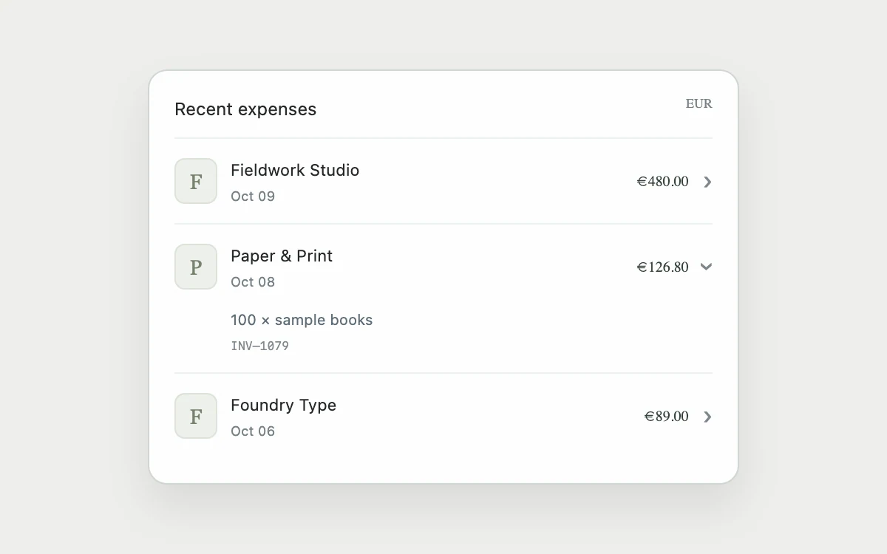

# Expandable ledger

> Explain a transaction in place instead of navigating away from the ledger.

- **Common name:** Expandable table rows
- **Category:** Components & interactions
- **Live demo:** https://www.subframe.com/motion/expandable-ledger
- **Source:** Subframe (original, MIT)
- **Dependencies:** none

## Use case

Explain a transaction in place instead of navigating away from the ledger.

## Interaction

Open a line item

## Look

Light warm-grey page with a single white rounded card listing expenses: lettered serif avatar tiles, sans names and dates, right-aligned amounts and chevrons.

## Motion

Clicking a row grows its detail from 0fr to 1fr grid rows over 210 ms ease-out as the chevron turns 90°; opening one row closes the previous one.

## How to adapt

`.ledger-detail` animates `grid-template-rows` (0fr to 1fr, 210ms) when `open` matches the row index, and `.ledger-chevron` rotates alongside. Replace the `rows` array; keep the `data-keyboard` and `data-paused` rules that zero transitions.

## Reduced motion

Live system preference disables decorative motion; all controls remain usable. Keyboard actions settle immediately.

## Limitations

Fictional ledger data. Totals and details are for presentation, not financial calculations.

## Taxonomy

- **Components:** table, disclosure
- **Triggers:** press
- **Techniques:** layout, rotate
- **Feel:** subtle
- **Contexts:** app, dashboard
- **Tags:** ledger, table, disclosure, finance, transaction
- **Also known as:** accordion rows, collapsible transaction details, inline row details, expense list accordion
- **Surface color:** `#edf0f3`

## Code

See [`component.tsx`](component.tsx).
