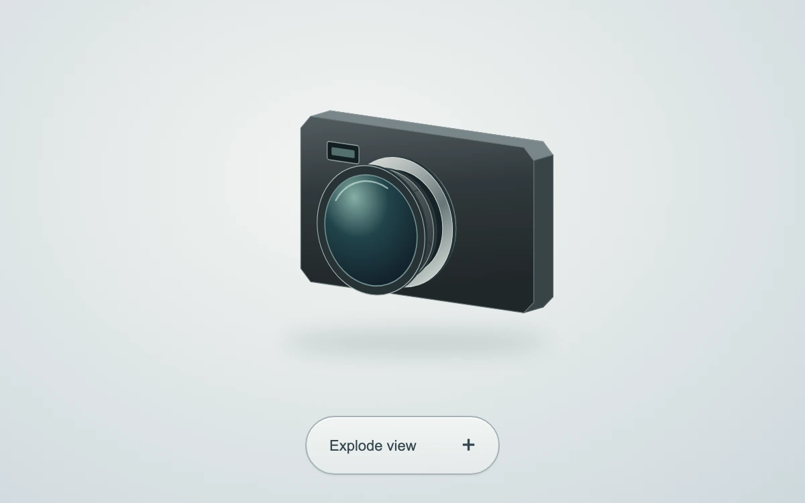

# Inside the lens

> A graphite camera separates into a silver mount, an iris and a coated glass element along one continuous axis.

- **Common name:** Exploded product view
- **Category:** Animation & motion
- **Live demo:** https://www.subframe.com/motion/exploded-camera
- **Source:** Subframe (original, MIT)
- **Dependencies:** none

## Use case

Explain a layered product through a clear, reversible exploded illustration.

## Interaction

Click the camera or the Explode view control to separate or assemble the optics.

## Look

Soft grey-white radial backdrop with a graphite compact camera in angled projection, silver lens mount, teal coated glass, soft floor shadow and a pill button.

## Motion

Clicking slides the silver mount, iris and glass apart along the lens axis as the body shifts back, 600 ms with a strong ease-out; clicking again reassembles them.

## How to adapt

Parts are SVG groups with class `ec-part` animated by `transition:transform 600ms cubic-bezier(.22,1,.36,1)`; `opticalDepth` sets each element's distance along the projected axis via `basis`, and `plane` and `face` handle the fixed 35° projection. Replace the camera artwork and depth values.

## Reduced motion

The optical assembly changes pose immediately for keyboard and reduced motion. Host pause disables both controls and settles the current pose.

## Limitations

A stylized projected SVG assembly, not a physically accurate lens prescription, CAD model or manufacturing diagram. The view angle is authored and fixed.

## Taxonomy

- **Components:** scene
- **Triggers:** press
- **Techniques:** 3d, slide
- **Feel:** refined, technical
- **Contexts:** landing, editorial
- **Tags:** 3D, exploded view, product, assembly, lens, SVG, optics, camera, iris
- **Also known as:** product teardown animation, lens layers separating, assembly diagram, component breakdown illustration
- **Surface color:** `#dce3e5`

## Code

See [`component.tsx`](component.tsx).
