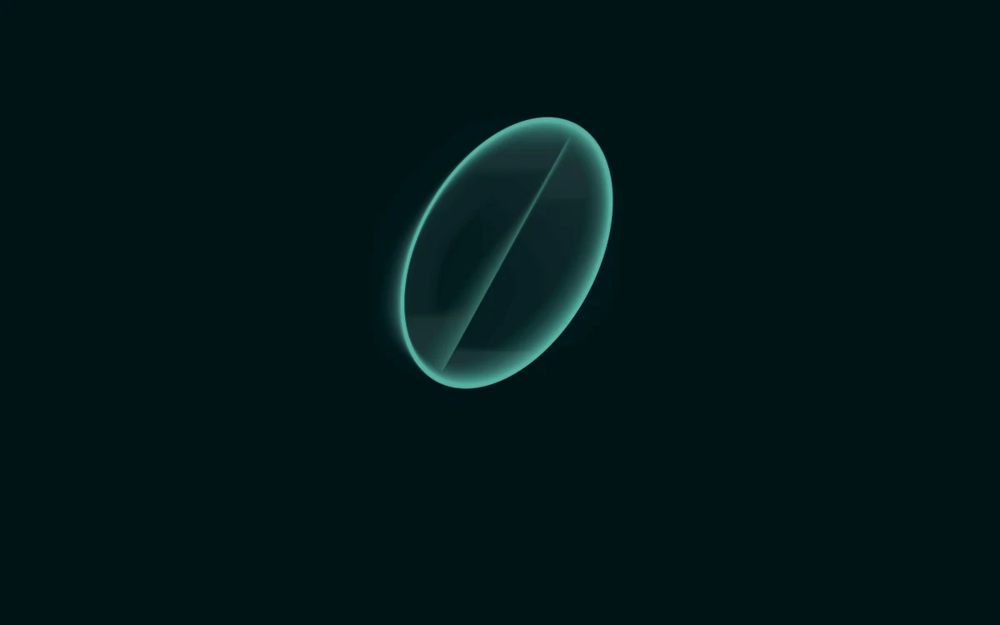

# Feedback echo

> A precise luminous orbit leaves a retained echo that slowly stretches and fades.

- **Common name:** Feedback trail shader
- **Category:** WebGL & shaders
- **Live demo:** https://www.subframe.com/motion/feedback-echo
- **Source:** Subframe (original, MIT)
- **Dependencies:** none

## Use case

Art-direct trails from actual previous frames with a controlled decay rate.

## Interaction

Adjust persistence.

## Look

Near-black teal field with one glowing teal elliptical ring crossed by a fine diagonal line, faint ghosted afterimages trailing inside it.

## Motion

A thin ring and bar drift, rotate and shift gold to teal; each frame redraws the last slightly contracted, shifted left and dimmed, leaving trailing echoes; a slider sets persistence.

## How to adapt

The `FRAGMENT` shader draws the orbit and blends the previous frame from `u_state`, which `draw` refreshes via `copyTexSubImage2D`. Swap the `ring` and `bar` shapes, tune decay and zoom there and `controlRef` (0.73); keep context-loss and reduced-motion handling.

## Reduced motion

A representative retained-history composition stays still. Persistence changes render one frame.

## Limitations

Requires WebGL 1; a static CSS swatch appears if unavailable or after context loss. One retained RGBA8 framebuffer texture with frame-rate-adjusted decay; feedback history resets on resize and remount.

## Taxonomy

- **Components:** background
- **Triggers:** ambient
- **Techniques:** shader, glow, gradient
- **Feel:** calm, technical
- **Contexts:** landing, editorial
- **Tags:** native webgl, feedback, framebuffer, afterimage, persistent state, trail
- **Also known as:** motion trail effect, afterimage shader, framebuffer feedback, ghosting trails, echo trail background
- **Surface color:** `#09282c`

## Code

See [`component.tsx`](component.tsx).
