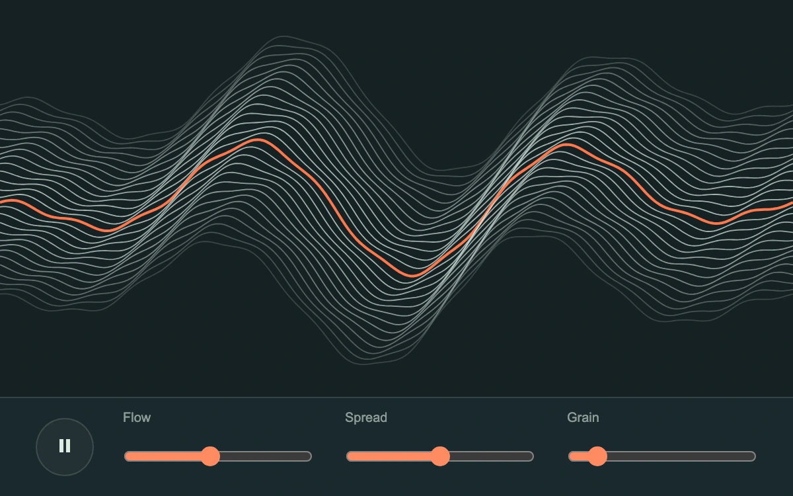

# Field console

> A full-width field of fine contours bends under a direct drag, with one orange trace revealing its motion.

- **Common name:** XY pad controller
- **Category:** Components & interactions
- **Live demo:** https://www.subframe.com/motion/field-console
- **Source:** Subframe (original, MIT)
- **Dependencies:** none

## Use case

Expressive two-axis controls for synthesis, motion studies and procedural visual modulation.

## Interaction

Drag the wave field or hold arrow keys; adjust flow, spread and grain.

## Look

Dark slate-teal field of pale stacked wave contours with one orange trace, above a control bar holding a round pause button and three orange sliders.

## Motion

Wave lines drift continuously at a flow-set speed; the dragged XY point sets frequency (right is higher) and amplitude (up is taller), easing back to centre on release.

## How to adapt

`render` draws 28 canvas polylines from `frequency`, `amp` and `flow`, `spread` and `grain` in `parameters`; `update` writes the XY `target` and `1 - Math.exp(-dt * 20)` eases `current` toward it. Recolour the `#ff784c` trace and remap `target` to your own controls.

## Reduced motion

The wave clock stops and release returns immediately; manual XY and parameter changes still redraw.

## Limitations

Procedural visual waves, without audio synthesis, frequency analysis or device communication.

## Taxonomy

- **Components:** slider, media
- **Triggers:** drag, ambient, keyboard
- **Techniques:** canvas
- **Feel:** technical, calm
- **Contexts:** app, landing
- **Tags:** xy, waveform, canvas, contour, field, controller, instrument, modulation
- **Also known as:** two-axis control pad, waveform modulation pad, animated contour lines, synth performance pad
- **Surface color:** `#172125`

## Code

See [`component.tsx`](component.tsx).
