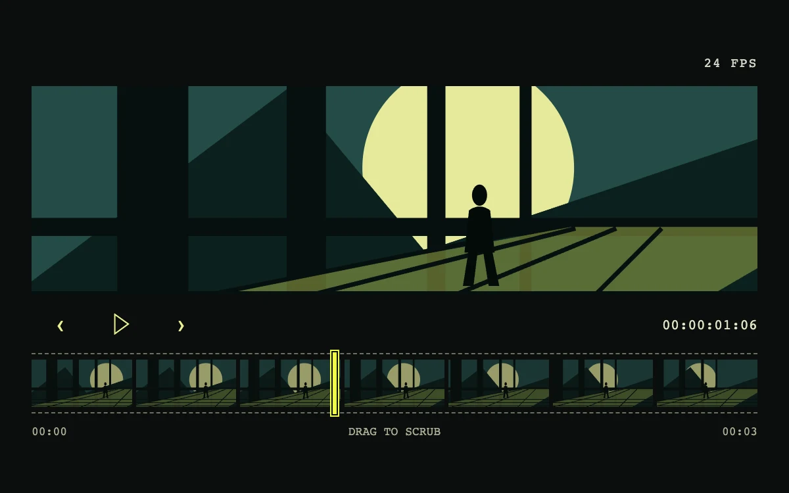

# Night signal

> An acid-yellow playhead scrubs a nocturnal scene one frame at a time.

- **Common name:** Video frame scrubber
- **Category:** Components & interactions
- **Live demo:** https://www.subframe.com/motion/filmstrip-scrubber
- **Source:** Subframe (original, MIT)
- **Dependencies:** none

## Use case

Give an editor or creative review tool a direct relationship between a thumbnail timeline and its current visual frame.

## Interaction

Drag the filmstrip, step frames, or play the sequence

## Look

Near-black editor showing a flat teal silhouette night scene with a pale moon above a seven-thumbnail strip, acid-yellow playhead and monospace timecode.

## Motion

Dragging the strip's range thumb or stepping frames redraws the SVG scene, its moon, structure and figure sliding left at different rates; play advances 73 frames at 24 fps, looping.

## How to adapt

`frame` drives `NightScene`, whose layers offset by `travel`; playback is the 24 fps `tick` loop and scrubbing is the native range over `sf-film-strip`. Swap `NightScene` and the thumbnail frames for real video frames, keeping `step` and the reduced-motion branch.

## Reduced motion

Autoplay is unavailable; the scrubber and previous/next controls jump directly to the requested frame. The preference updates live.

## Limitations

The 73-frame SVG composition is deterministic artwork, not a video decoder. Connect a media timeline and generated thumbnails for actual footage.

## Taxonomy

- **Components:** media, editor, slider
- **Triggers:** drag, press
- **Techniques:** parallax, slide
- **Feel:** technical
- **Contexts:** app
- **Tags:** filmstrip, timeline, scrubber, frame, playback, video, editor, SVG, cinematic, acid yellow, dark, native range, keyboard
- **Also known as:** thumbnail timeline, filmstrip seek bar, frame-by-frame stepper, video editor playhead
- **Surface color:** `#0b0e0d`

## Code

See [`component.tsx`](component.tsx).
