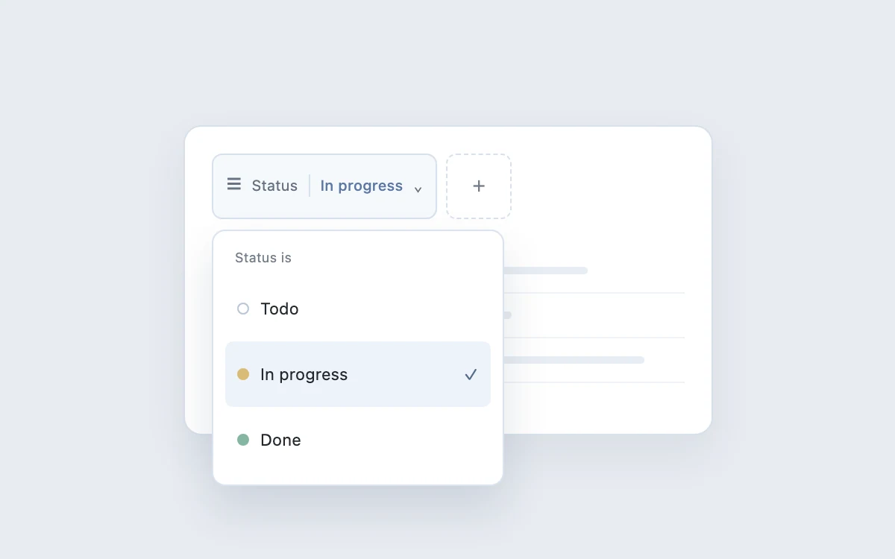

# Filter builder

> Make a compound filter editable in place without a full settings panel.

- **Common name:** Filter chips builder
- **Category:** Components & interactions
- **Live demo:** https://www.subframe.com/motion/filter-builder
- **Source:** Subframe (original, MIT)
- **Dependencies:** none

## Use case

Make a compound filter editable in place without a full settings panel.

## Interaction

Build a filter

## Look

Pale blue-grey page with a white card: a bordered filter chip, dashed add button, grey skeleton rows and a dropdown popover with coloured status dots.

## Motion

Pressing the chip fades in the popover as it scales up from 0.98 at its top-left origin and drops 4 px (180 ms ease-out); picking a status closes it.

## How to adapt

The popover is CSS on `.filter-popover` toggled by `data-open` (`opacity 150ms ease, transform 180ms cubic-bezier(.22,1,.36,1)` from `translateY(-4px) scale(0.98)`). Replace the status options, `assignee` toggle and placeholder `results` with real filter fields; keep `inert` and Escape-to-close.

## Reduced motion

Live system preference disables decorative motion; all controls remain usable. Keyboard actions settle immediately.

## Limitations

Synthetic result rows visualize filter state; no data query is performed.

## Taxonomy

- **Components:** menu, input
- **Triggers:** press
- **Techniques:** fade, scale, slide
- **Feel:** subtle
- **Contexts:** app, dashboard
- **Tags:** filter, popover, query, status, chips
- **Also known as:** filter pill dropdown, status filter popover, query builder, faceted filter
- **Surface color:** `#edf0f3`

## Code

See [`component.tsx`](component.tsx).
