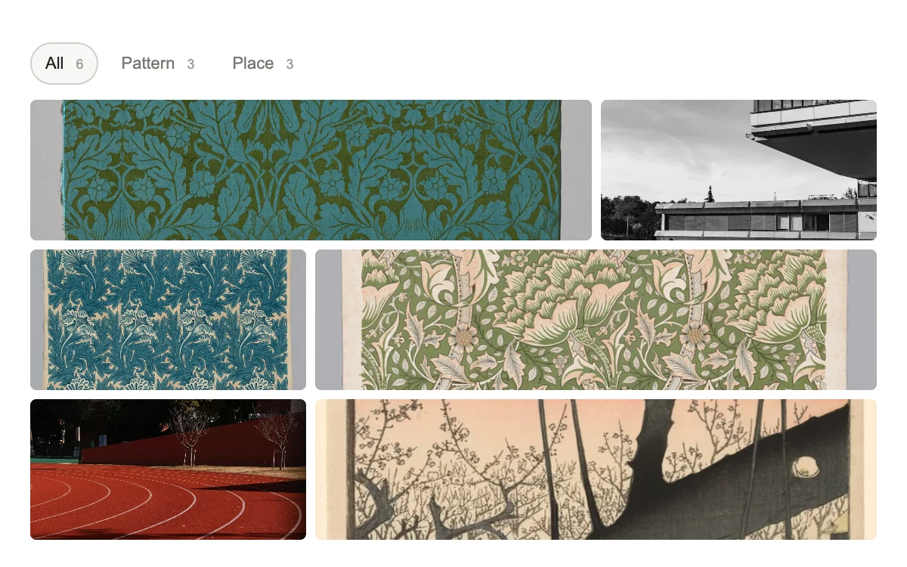

# Filter mosaic

> A tiled collection of textile patterns and places rearranges around the selected category.

- **Common name:** Animated filter grid
- **Category:** Components & interactions
- **Live demo:** https://www.subframe.com/motion/filter-mosaic
- **Source:** Subframe (original, MIT)
- **Dependencies:** none

## Use case

Filter a visual collection without losing the identity of items that remain.

## Interaction

Choose a category and select a tile.

## Look

White page with pill filter chips over a mixed-width grid of image tiles: botanical textile prints, concrete architecture, a red running track, a woodblock print.

## Motion

Choosing a filter chip reflows the grid; surviving tiles FLIP from their old rectangles to new ones over 280 ms ease-out, newly shown tiles fade in over 180 ms.

## How to adapt

`select` records each `data-tile` rectangle before `setFilter`; a `useLayoutEffect` then inverts the delta with `el.animate` (280 ms `cubic-bezier(.22,1,.36,1)`) and fades new tiles over 180 ms. Replace `tiles` (`file`, `name`, `kind`) and filter values; `fm-wide` sets which tiles span two columns.

## Reduced motion

The layout and selection change immediately; categories and image labels remain available.

## Limitations

Six local works in three preset categories. The layout uses measured FLIP transforms rather than a general masonry engine.

## Taxonomy

- **Components:** gallery
- **Triggers:** press, state
- **Techniques:** layout, fade
- **Feel:** refined, subtle
- **Contexts:** editorial, app
- **Tags:** filter, grid, FLIP, layout, image collection
- **Also known as:** filterable image grid, portfolio category filter, masonry filter, FLIP grid filter, category filter gallery
- **Surface color:** `#efede6`

## Assets

- [`concrete-projections.webp`](../../assets/concrete-projections.webp) — Brutalist concrete office building (Unsplash)
- [`oak-damask.webp`](../../assets/oak-damask.webp) — Oak (CC0-1.0)
- [`plum-garden.webp`](../../assets/plum-garden.webp) — Plum Garden at Kameido (Kameido Umeyashiki), from the series "One Hundred Famous Views of Edo (Meisho Edo hyakkei)" (CC0-1.0)
- [`running-track.webp`](../../assets/running-track.webp) — Curving red running track with white lane lines (Unsplash)
- [`tulip-print.webp`](../../assets/tulip-print.webp) — Tulip (CC0-1.0)
- [`windrush-print.webp`](../../assets/windrush-print.webp) — Windrush (CC0-1.0)

## Code

See [`component.tsx`](component.tsx).
