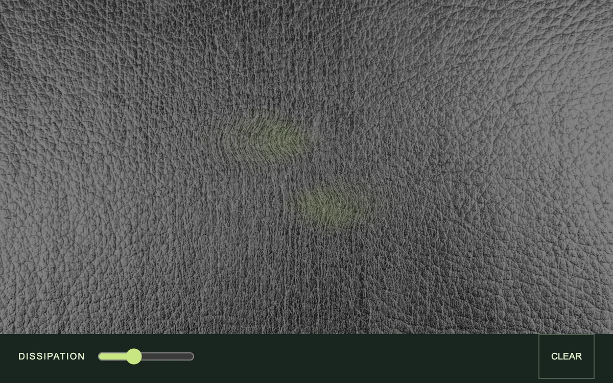

# Flow memory

> A metallic surface remembers the currents drawn across it as color and refraction.

- **Common name:** Fluid simulation shader
- **Category:** WebGL & shaders
- **Live demo:** https://www.subframe.com/motion/flow-memory
- **Source:** Subframe (original, MIT)
- **Dependencies:** none

## Use case

Explore a persistent fluid gesture whose velocity continues to transport the material.

## Interaction

Move across the surface to stir it.

## Look

Full-bleed silver-grey embossed leather texture with faint lime-green tinted swirls, above a dark green footer bar with a lime slider and outlined button.

## Motion

Moving the pointer injects velocity and lime dye into a 64×64 fluid grid that keeps advecting, warping the leather texture as currents drift and dye fades at the set dissipation.

## How to adapt

The CPU solver `step` runs on a `GRID` × `GRID` field and `inject` adds pointer velocity and dye; the fragment shader displaces `u_image` by `u_flow` and mixes a lime tint. Swap `silver-leather.webp`, tune `decay` and the splat force, and keep `fm-fallback`.

## Reduced motion

The simulation clock stops; deliberate pointer or keyboard input produces a finite still update.

## Limitations

Requires WebGL 1; static fallback when unavailable. A bounded 64×64 CPU velocity/dye solver with 12 pressure iterations rendered through a WebGL texture, not GPU compute.

## Taxonomy

- **Components:** background, image
- **Triggers:** pointer
- **Techniques:** shader, distortion, physics
- **Feel:** refined, calm
- **Contexts:** landing, editorial
- **Tags:** native webgl, fluid, advection, pressure projection, persistent state, refraction, image, brush, stroke, painting
- **Also known as:** fluid cursor effect, interactive fluid background, liquid distortion hover, WebGL fluid, smoke trail shader
- **Surface color:** `#18251f`

## Assets

- [`silver-leather.webp`](../../assets/silver-leather.webp) — Textured silver metallic leather (Unsplash)

## Code

See [`component.tsx`](component.tsx).
