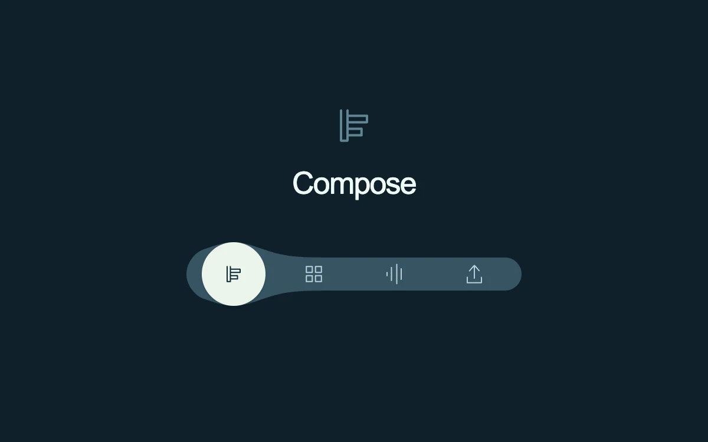

# Fluid tab rail

> A deep-blue navigation rail swells around the focused control while a pale disc follows its silhouette.

- **Common name:** Liquid tab indicator
- **Category:** Components & interactions
- **Live demo:** https://www.subframe.com/motion/fluid-tab-rail
- **Source:** Subframe (original, MIT)
- **Dependencies:** none

## Use case

Connect hover preview, keyboard focus and selected workspace state with one coherent navigation shape.

## Interaction

Hover or select a mode. Arrow keys, Home and End select immediately.

## Look

Dark navy page with a centred line icon and large sans-serif label above a slate pill-shaped icon rail whose bulge cradles a pale mint disc.

## Motion

Hovering a tab glides a pale disc there (exponential smoothing, 65 ms constant) while a Gaussian bulge in the SVG rail follows; leaving glides it back, keyboard moves are instant.

## How to adapt

The disc `point` eases in a `requestAnimationFrame` loop (`Math.exp(-dt / 65)`) and the rail `hull` is rebuilt each frame from the Gaussian `profile` (spread 32, height 13). Replace `LABELS` and `SYMBOLS`; the 68 px tab pitch and count of four are hard-coded.

## Reduced motion

The rail and disc move directly to the target with no interpolated motion.

## Limitations

Four local modes with symbolic previews; connect the selected index to real panels in a product.

## Taxonomy

- **Components:** tabs, navigation
- **Triggers:** hover, press, keyboard
- **Techniques:** morph, slide
- **Feel:** refined, playful
- **Contexts:** app
- **Tags:** tabs, navigation, svg, morph, roving-focus, hull, hover
- **Also known as:** gooey tab bar, morphing nav indicator, blob tab selector, animated tab bar, metaball navigation
- **Surface color:** `#0e2029`

## Code

See [`component.tsx`](component.tsx).
