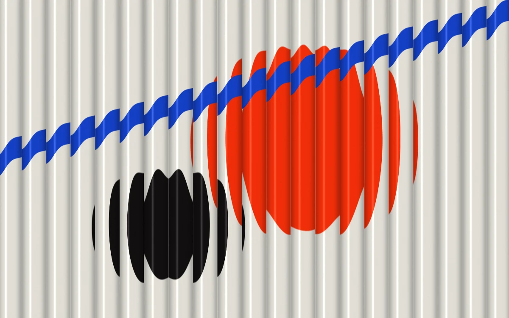

# Fluted prism

> Sculptural color bends behind a sheet of ribbed architectural glass.

- **Common name:** Fluted glass shader
- **Category:** WebGL & shaders
- **Live demo:** https://www.subframe.com/motion/fluted-prism
- **Source:** Subframe (original, MIT)
- **Dependencies:** none

## Use case

Layer original brand artwork with tactile glass distortion while keeping text on a separate plane.

## Interaction

Adjust refraction

## Look

Off-white vertical fluted glass over a vermilion disc, a black disc and a diagonal cobalt bar, each sliced and offset by the ribs.

## Motion

The red disc drifts slowly side to side on a roughly 30 s sine cycle behind fixed glass ribs; the refraction slider widens each flute's sideways displacement.

## How to adapt

Everything is the `FRAGMENT` shader: `scene` paints the artwork behind the glass, `(p.x+.04)*13.0` sets flute density and `u_control` scales the bend. Replace the shapes in `scene`; keep `sg-fluted-prism-fallback` and the context-loss and reduced-motion handling.

## Reduced motion

A representative frame remains still. Live system preference changes immediately stop the loop; the range control continues to update the still image.

## Limitations

Requires WebGL 1. A static CSS fallback appears when unavailable or after context loss. Analytic refraction of included procedural art; it does not refract arbitrary page DOM.

## Taxonomy

- **Components:** background
- **Triggers:** ambient, state
- **Techniques:** shader, distortion
- **Feel:** refined, calm
- **Contexts:** landing, editorial
- **Tags:** glass, refraction, ribbed, architectural, material, native webgl
- **Also known as:** reeded glass effect, ribbed glass background, glass refraction hero, striped lens distortion
- **Surface color:** `#e2ddd4`

## Code

See [`component.tsx`](component.tsx).
