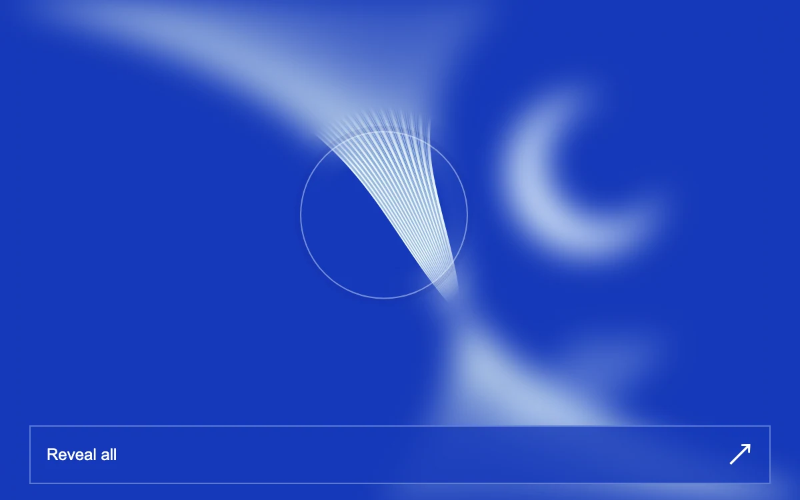

# Focus lens

> A moving aperture brings fine silver lines into focus over an ultramarine optical plate.

- **Common name:** Cursor focus lens
- **Category:** Components & interactions
- **Live demo:** https://www.subframe.com/motion/focus-lens
- **Source:** Subframe (original, MIT)
- **Dependencies:** none

## Use case

Exploring fine imagery, material details, or a progressive focus reveal.

## Interaction

Move the lens, use arrow keys, or reveal the full artwork

## Look

Saturated ultramarine field of fine pale silver-blue curved lines and a crescent, blurred except inside a thin circular ring, with an outlined full-width button bar.

## Motion

A 126 px ring eases toward the pointer with exponential smoothing, opening a sharp aperture in a 13 px-blurred overlay via a moving radial mask; arrow keys move it instantly.

## How to adapt

`tick` eases `point` toward `target` (rate 18 in `Math.exp`) and `paint` writes the `.sf-focus-veil` `maskImage` and ring transform; tune the 82px circle, 52% clear stop and 13px blur. Replace `OpticalPlate` (rendered twice) with your artwork.

## Reduced motion

The aperture follows directly instead of easing. Reveal all provides a still full view.

## Limitations

Uses a blurred duplicate and radial CSS mask; does not magnify pixels or simulate refraction.

## Taxonomy

- **Components:** cursor, image
- **Triggers:** pointer, drag, keyboard
- **Techniques:** blur, mask
- **Feel:** refined, calm
- **Contexts:** landing, editorial
- **Tags:** lens, mask, blur, focus, pointer, reveal, optical
- **Also known as:** blur reveal cursor, focus spotlight, unblur on hover, depth-of-field hover
- **Surface color:** `#1538b9`

## Code

See [`component.tsx`](component.tsx).
