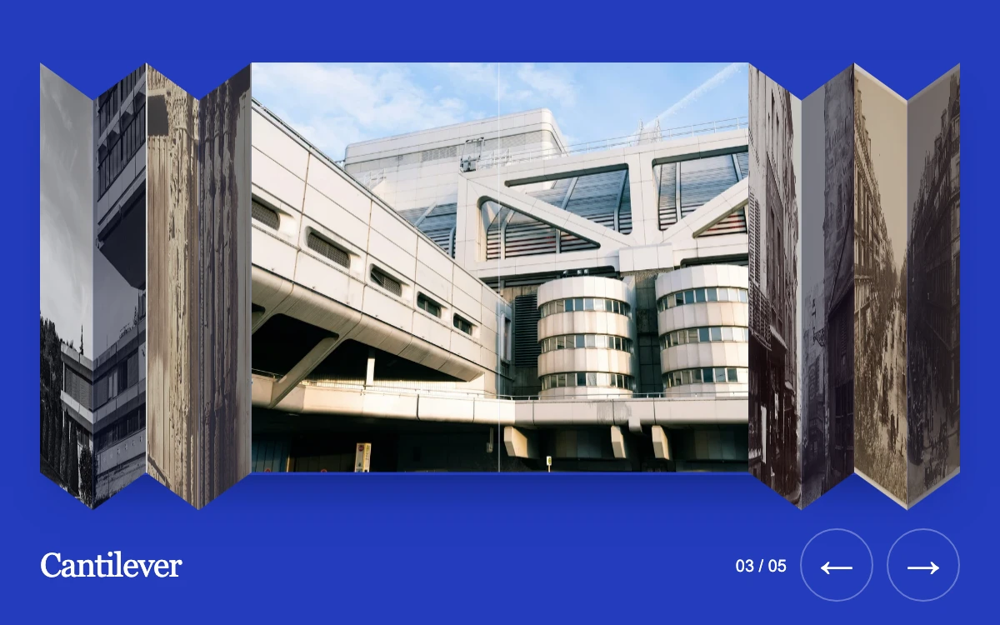

# Folded contact sheet

> An architectural contact sheet unfolds the selected photograph while its neighbors close into connected paper folds.

- **Common name:** Folding photo carousel
- **Category:** Animation & motion
- **Live demo:** https://www.subframe.com/motion/focus-rail
- **Source:** Subframe (original, MIT)
- **Dependencies:** none

## Use case

Browse a short photographic collection while keeping every image spatially connected.

## Interaction

Drag the photographs, choose one, or use the arrows. Left, Right, Home and End navigate directly.

## Look

Cobalt-blue field with a strip of architectural photographs, one open flat and the rest folded into zigzag paper pleats, serif caption and round arrow buttons.

## Motion

Dragging, clicking or the arrow buttons drive a spring-smoothed focus position; photo widths follow it and each photo's two halves fold in 3D like a concertina, darkening as they close.

## How to adapt

The `paint` function divides `available` by distance weights to calculate each photo's projected width. Fixed-size `.fc-half` spans fold with `Math.acos(Math.min(1, width / flat))` and translate in 3D; their HTML width is not tweened. Geometry is measured on resize, while `tick` springs `position` toward `target` (`270`, `32`). Replace `photographs` and their captions.

## Reduced motion

Selection changes are immediate; direct dragging remains available. Host pause freezes spring interpolation.

## Limitations

Five local photographs with bounded selection; no wrapping, routing or separate lightbox.

## Taxonomy

- **Components:** gallery
- **Triggers:** drag, press, keyboard
- **Techniques:** 3d, spring, layout
- **Feel:** refined
- **Contexts:** editorial, landing
- **Tags:** carousel, accordion, photography, 3D fold, continuous drag, image selection, paper, spring, roving focus
- **Also known as:** accordion image slider, concertina gallery, folded paper photo strip, expanding panel gallery
- **Surface color:** `#243cbd`

## Assets

- [`cathedral-columns.webp`](../../assets/cathedral-columns.webp) — Chartres Cathedral, West Facade; Royal Portal, Central Bay (CC0-1.0)
- [`concrete-geometries.webp`](../../assets/concrete-geometries.webp) — Modern brutalist architecture with geometric shapes (Unsplash)
- [`concrete-projections.webp`](../../assets/concrete-projections.webp) — Brutalist concrete office building (Unsplash)
- [`montmartre.webp`](../../assets/montmartre.webp) — Montmartre (CC0-1.0)
- [`paris-street.webp`](../../assets/paris-street.webp) — Rue de la Montagne-Sainte-Geneviève near the Intersection of Rue LaPlace (Rue de la Montagne-Sainte-Geneviève prés de carrefour de la rue LaPlace) (CC0-1.0)

## Code

See [`component.tsx`](component.tsx).
