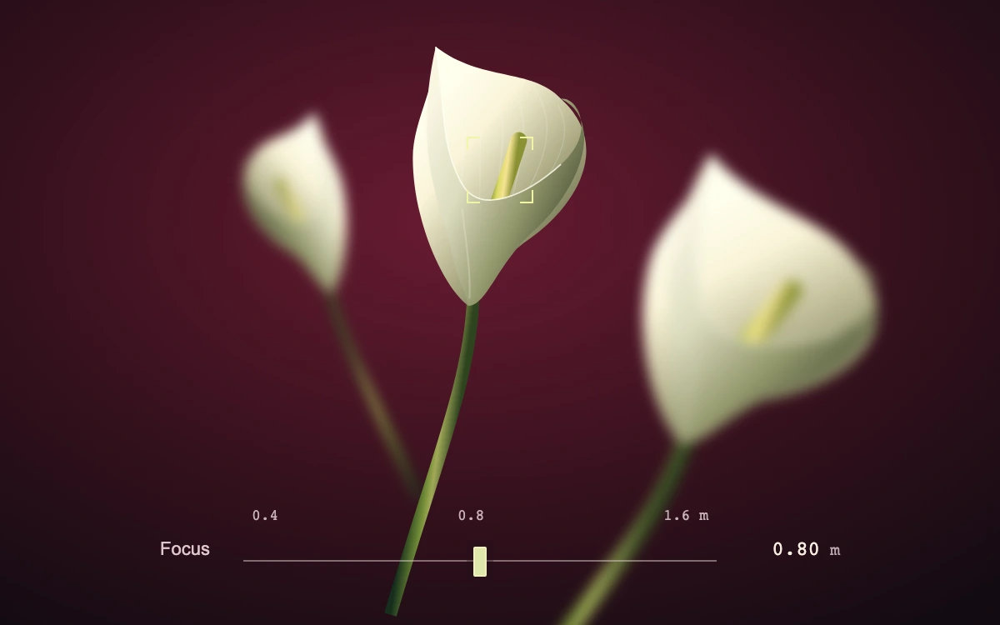

# Botanical focus pull

> Three sculptural calla lilies resolve at different depths as the focal plane moves through an oxblood still life.

- **Common name:** Depth of field focus pull
- **Category:** Animation & motion
- **Live demo:** https://www.subframe.com/motion/focus-stack
- **Source:** Subframe (original, MIT)
- **Dependencies:** none

## Use case

Direct attention through a layered editorial scene or preview a camera's focus control with recognizable subjects.

## Interaction

Select a flower or move the focus rail.

## Look

Deep oxblood vignette backdrop with three ivory calla lilies on green stems at different depths, one sharp and two blurred, plus a thin focus rail.

## Motion

Clicking a lily pulls focus to it, easing every flower's blur to its depth offset over 260 ms ease-out; dragging the focus rail changes blur directly.

## How to adapt

Defocus is the inline `filter` blur on each `sf-botanical-focus-plane`, computed as `Math.abs(flower.depth - depth) * 0.075` px and eased by its 260 ms transition. Replace the lily paths and the `subjects` array (position, size, angle, `depth`) with your own layered artwork.

## Reduced motion

Subject selection and manual focus changes are immediate. The normal 260 ms focus pull is removed; there is no idle animation.

## Limitations

Original vector botanical artwork at three authored depth planes. CSS Gaussian blur approximates defocus; this is not a thin-lens solver or aperture-shaped bokeh renderer. The distance scale is illustrative.

## Taxonomy

- **Components:** image, scene
- **Triggers:** press, drag
- **Techniques:** blur
- **Feel:** refined, calm
- **Contexts:** editorial, landing
- **Tags:** depth of field, focus pull, botanical, SVG, blur, photographic, still life, focus distance
- **Also known as:** rack focus, tap to focus, depth blur layers, camera focus control
- **Surface color:** `#32101c`

## Code

See [`component.tsx`](component.tsx).
