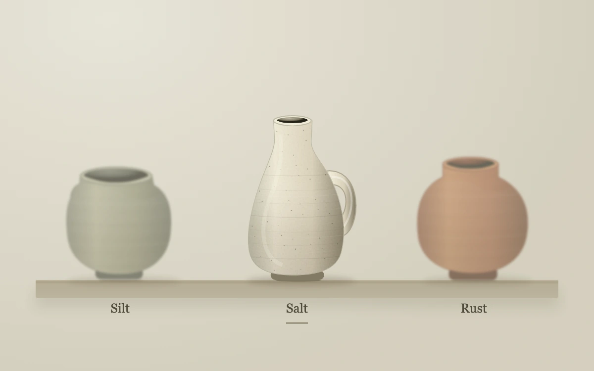

# Three vessels

> Three individually drawn ceramic forms reveal mineral grain, glazed rims and wheel marks as the selection moves into focus.

- **Common name:** Focus blur product gallery
- **Category:** Animation & motion
- **Live demo:** https://www.subframe.com/motion/focus-triptych
- **Source:** Subframe (original, MIT)
- **Dependencies:** none

## Use case

Give a compact object comparison a clear focal point while leaving every alternative visible.

## Interaction

Hover, focus or select a vessel.

## Look

Warm beige studio wall and shelf holding three illustrated ceramic vessels in sage, cream and terracotta, with serif names beneath and the unselected pots blurred.

## Motion

Hovering, focusing or clicking a vessel sharpens it while the other two blur 1.15 px and fade to 62% opacity over 240 ms; its name gains an underline.

## How to adapt

Focus is pure CSS: `button:not([aria-pressed=true]) .object` sets `blur(1.15px)` and `opacity:.62` with a 240 ms transition, keyed by `selected`. Replace the `vessels` data and `Vessel` SVG drawing with product images.

## Reduced motion

Focus and opacity states change immediately for keyboard use and reduced motion. Host pause disables selection.

## Limitations

Original SVG material illustrations with stylized lighting and static procedural grain, not photographs or physically based ceramic rendering.

## Taxonomy

- **Components:** gallery, picker
- **Triggers:** hover, keyboard, press
- **Techniques:** blur, fade
- **Feel:** refined, calm
- **Contexts:** landing, editorial
- **Tags:** focus, blur, product, gallery, selection, ceramic, material, SVG
- **Also known as:** depth of field hover, blur siblings on hover, dim others on hover, product selector, focus on hover
- **Surface color:** `#d 9d 5c 6`

## Code

See [`component.tsx`](component.tsx).
