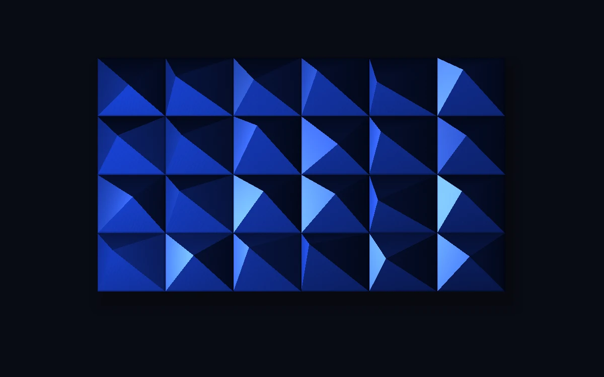

# Prismatic relief

> Raised ultramarine facets catch a moving light, revealing sharp ridges and shifting glints.

- **Common name:** Faceted relief shader
- **Category:** WebGL & shaders
- **Live demo:** https://www.subframe.com/motion/folded-paper-light
- **Source:** Subframe (original, MIT)
- **Dependencies:** none

## Use case

Art-direct an abstract material study or sculptural brand texture.

## Interaction

Rotate the light or pause its orbit

## Look

Near-black field with a rectangular six-by-four panel of cobalt pyramids with off-centre peaks, shaded deep navy to pale sky-blue highlights.

## Motion

A point light orbits the faceted panel about every 52 seconds, sweeping diffuse shading and specular glints across each pyramid face; the light slider offsets its angle.

## How to adapt

Facet geometry is `cellHit` (6×4 cells with hashed `peak` and height `h`) and lighting is in `main` of `FRAGMENT`; tune `angle` (orbit speed `u_time*.12`), `cobalt`, `bg` and the `spec` exponent. Keep the context-loss and reduced-motion handling.

## Reduced motion

Automatic light orbit stops. The light-angle control still redraws immediately.

## Limitations

Analytically projected height-field relief, not paper deformation or a full 3D mesh. Native WebGL1 with no 3D dependency; static fallback after context loss until remount.

## Taxonomy

- **Components:** background
- **Triggers:** ambient, state
- **Techniques:** shader, glow, 3d
- **Feel:** refined, calm
- **Contexts:** landing, editorial
- **Tags:** relief, facets, ultramarine, directional light, abstract, material, native webgl
- **Also known as:** pyramid tile texture, orbiting light material, faceted panel background, sculptural brand texture
- **Surface color:** `#090d20`

## Code

See [`component.tsx`](component.tsx).
