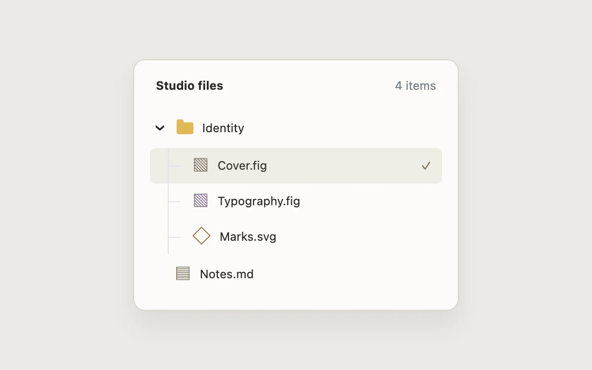

# Folder tree

> Reveal a project hierarchy while preserving where the selected file lives.

- **Common name:** File tree
- **Category:** Components & interactions
- **Live demo:** https://www.subframe.com/motion/folder-tree
- **Source:** Subframe (original, MIT)
- **Dependencies:** none

## Use case

Reveal a project hierarchy while preserving where the selected file lives.

## Interaction

Explore the file tree

## Look

Off-white rounded card on a warm grey page: a mustard folder icon, hatched file glyphs, thin tree guide lines and a beige selected row.

## Motion

Pressing the folder expands or collapses its children by animating grid rows between 0fr and 1fr (220 ms ease-out) as the chevron rotates 90° over 180 ms.

## How to adapt

The collapse is `.branch` transitioning `grid-template-rows` between inline `1fr` and `0fr` with `220ms cubic-bezier(0.2, 0.8, 0.2, 1)` over an `overflow: hidden` child; `inert` disables collapsed rows. Replace `files` and the folder label; nest the pattern for deeper trees.

## Reduced motion

Live system preference disables decorative motion; all controls remain usable. Keyboard actions settle immediately.

## Limitations

Semantic disclosure with native file buttons, not an ARIA tree widget requiring specialized tree keyboard conventions.

## Taxonomy

- **Components:** list, disclosure
- **Triggers:** press
- **Techniques:** layout, rotate
- **Feel:** subtle
- **Contexts:** app
- **Tags:** file tree, hierarchy, disclosure, navigation
- **Also known as:** file explorer sidebar, collapsible folder list, tree view, nested file navigation, project file browser
- **Surface color:** `#edf0f3`

## Code

See [`component.tsx`](component.tsx).
