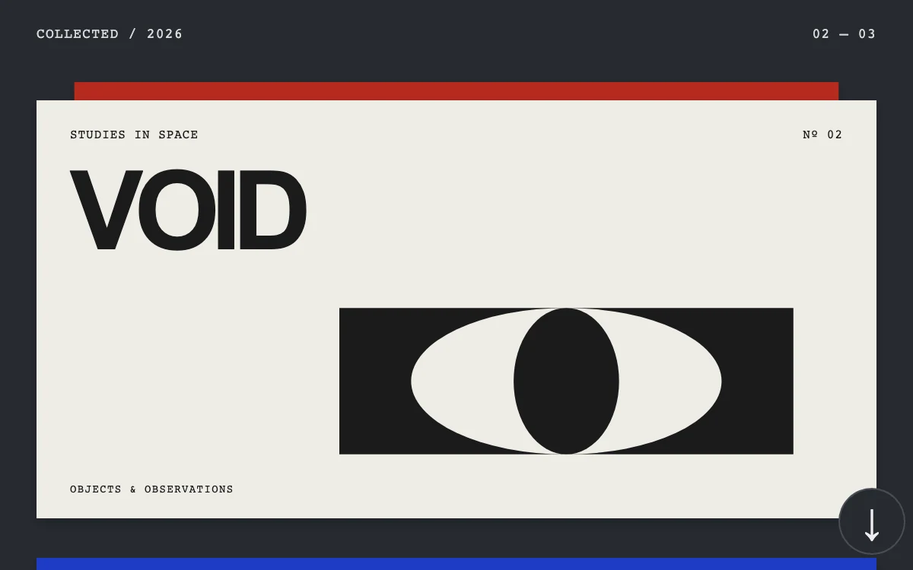

# Folio stack

> Three graphic folios pin and recede as the next cover enters the reading area.

- **Common name:** Sticky scroll card stack
- **Category:** Animation & motion
- **Live demo:** https://www.subframe.com/motion/folio-stack
- **Source:** Subframe (original, MIT)
- **Dependencies:** none

## Use case

Present a short sequence with spatial continuity and native scrolling.

## Interaction

Scroll through the folios.

## Look

Dark slate page with stacked full-width poster cards in red, off-white and cobalt, heavy sans titles, small monospace captions and geometric line art.

## Motion

Covers pin with CSS sticky in 12 px steps; as the next one scrolls over, the pinned cover scales to 0.91 and dims 20%, and an arrow button smooth-scrolls onward.

## How to adapt

Stacking is CSS: `.fs-slot` is `position:sticky` with `top` offset by index; the recede effect is the `update` handler mapping the next card's distance to `depth`, then `scale` and `brightness`. Replace `names`, `colors`, `inks` and the SVG covers.

## Reduced motion

Sticky positioning remains; scale, dimming and smooth programmatic scrolling are removed.

## Limitations

Three authored covers inside a bounded scroll area; not a virtualized list or page scroll controller.

## Taxonomy

- **Components:** card
- **Triggers:** scroll, press
- **Techniques:** scale
- **Feel:** bold, refined
- **Contexts:** editorial, landing
- **Tags:** sticky, stack, native scroll, editorial, scale, depth
- **Also known as:** stacking cards on scroll, sticky card deck, scroll stacked sections, pinned cards scroll, card stack scroll effect
- **Surface color:** `#262a30`

## Code

See [`component.tsx`](component.tsx).
