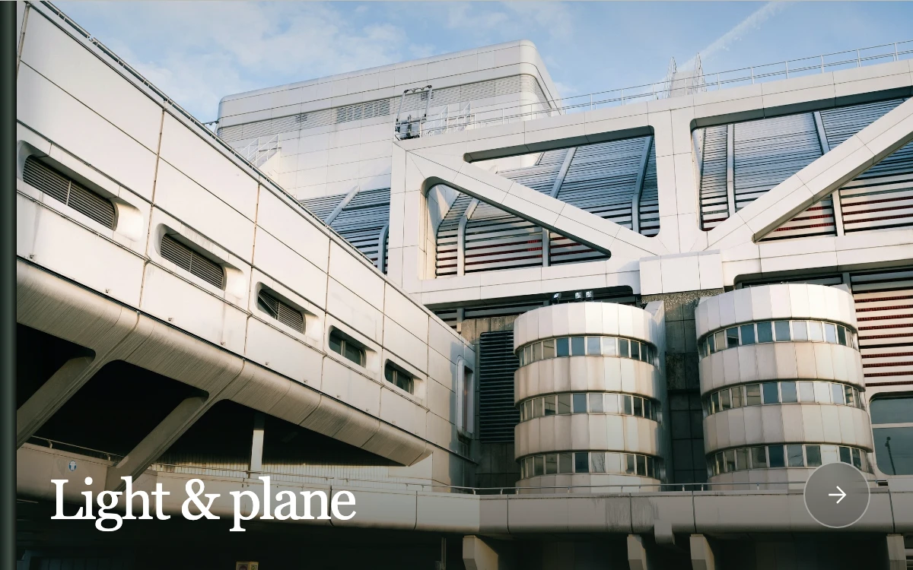

# Behind the shutter

> A near-black shutter snaps horizontally across a still photograph, concealing a scene change during a brief fully covered interval.

- **Common name:** Foreground occlusion scene transition
- **Category:** Animation & motion
- **Live demo:** https://www.subframe.com/motion/foreground-occlusion-wipe
- **Source:** Subframe (original, MIT)
- **Dependencies:** none

## Use case

Give a photographic scene change spatial continuity through an opaque foreground object.

## Interaction

Advance the architectural study. Another press queues one extra crossing; pause freezes the current frame.

## Look

Full-bleed concrete architecture with one restrained serif scene title. A near-black mechanical curtain with restrained seams passes horizontally across the photograph.

## Motion

Two fast horizontal strokes share 220 ms of travel with a 40 ms covered hold by default. The photograph remains still and changes only under full coverage. At most one extra advance is queued; host pause and document hiding freeze the cycle.

## How to adapt

Replace `SCENES` with local photographs. `Take` snapshots the timing and direction per crossing. `crossingMs`, `occluderWidth`, `coveredHoldMs` and `direction` affect the next advance; keep the full-coverage swap invariant in `tick`.

## Reduced motion

Pressing the next control switches scenes immediately. Keyboard actions also skip the traversal. Host pause freezes elapsed time and resumes from that point.

## Limitations

Two local photographs and an independently authored CSS shutter. This is a directed photographic transition, not extracted depth geometry or a physically simulated camera.

## Taxonomy

- **Components:** scene, image, gallery
- **Triggers:** press, keyboard
- **Techniques:** slide, mask
- **Feel:** refined, calm
- **Contexts:** editorial, landing
- **Tags:** foreground occlusion, scene transition, shutter, wipe, camera, image reveal, covered swap
- **Also known as:** foreground wipe, hidden scene cut, architectural shutter transition, occluder scene swap, camera shutter transition
- **Surface color:** `#111213`

## Assets

- [`shutter-concrete-geometries.webp`](../../assets/shutter-concrete-geometries.webp) — Angular white concrete architecture (Unsplash)
- [`shutter-concrete-projections.webp`](../../assets/shutter-concrete-projections.webp) — Projecting concrete office building (Unsplash)

## Code

See [`component.tsx`](component.tsx).
