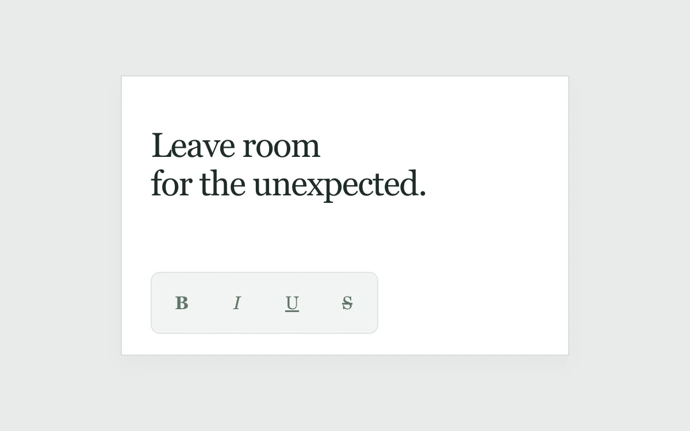

# Format tooltip

> A shared tooltip moves between formatting controls after one initial hover delay.

- **Common name:** Toolbar tooltip
- **Category:** Components & interactions
- **Live demo:** https://www.subframe.com/motion/format-tooltip
- **Source:** Subframe (original, MIT)
- **Dependencies:** none

## Use case

Teach a toolbar without making each neighboring control wait again.

## Interaction

Hover across the group, focus controls with Tab, or toggle formatting.

## Look

Light grey-green page with a white document card of dark serif text and a pale rounded toolbar of four serif formatting glyph buttons.

## Motion

First hover waits 400 ms before the tooltip fades in and rises 4 px; moving across the group while warm, it glides between buttons over 160 ms without re-waiting.

## How to adapt

Delay logic lives in `show` and `hide`: a 400 ms cold delay, with `warmUntil` extended 800 ms on show and 650 ms on leave; `.tip` slides by `(tip ?? 0) * 48` px. Replace `names` and adjust the 48 px step.

## Reduced motion

Hints change position immediately; timing, dismissal and formatting remain usable.

## Limitations

One local four-button toolbar; this is not a portal-based positioning engine.

## Taxonomy

- **Components:** tooltip, button
- **Triggers:** hover, keyboard, press
- **Techniques:** slide, fade
- **Feel:** subtle
- **Contexts:** app
- **Tags:** tooltip, warm-delay, cold-delay, group, focus, hover, toolbar, formatting
- **Also known as:** shared tooltip, tooltip warm-up delay, sliding tooltip, formatting toolbar hints
- **Surface color:** `#e8ebe9`

## Code

See [`component.tsx`](component.tsx).
