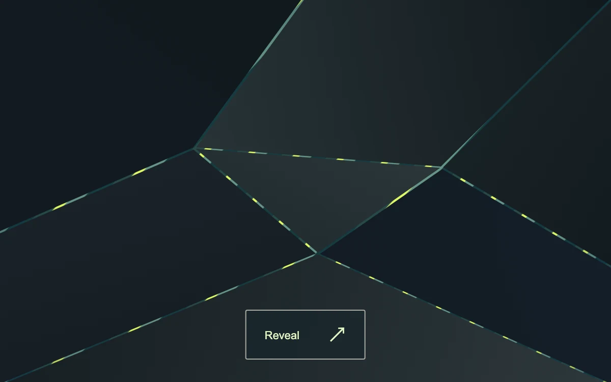

# Fault line

> A fractured stone surface opens into a vivid mineral field.

- **Common name:** Shatter transition
- **Category:** Animation & motion
- **Live demo:** https://www.subframe.com/motion/fracture-reveal
- **Source:** Subframe (original, MIT)
- **Dependencies:** none

## Use case

Reveal an unexpected colour or alternate material through a single deliberate action.

## Interaction

Break apart or restore

## Look

Dark slate surface split into seven angular charcoal shards, with acid-lime and teal mineral stripes glinting through thin cracks and a small outlined button.

## Motion

Pressing pushes seven clip-path shards apart, rotating them and shrinking to 0.8 over 0.7 s ease-out with a 25 ms stagger, exposing the striped mineral; pressing again reassembles them.

## How to adapt

Shard outlines are the `pieces` polygon strings; the open pose is each shard's inline `transform` (index-based offsets, `(i - 3) * 8` degree rotation, `scale(.8)`) staggered by `transitionDelay` and eased by `.7s cubic-bezier(.22,.8,.2,1)`. Replace `.mineral` with the content to reveal.

## Reduced motion

Live reduced-motion preferences remove interpolation and decorative playback. All content and native controls remain available. Keyboard changes settle immediately.

## Limitations

Original demonstration content; adapt labels and state to the host product.

## Taxonomy

- **Components:** image, background
- **Triggers:** press
- **Techniques:** mask, rotate, slide, stagger
- **Feel:** bold, refined
- **Contexts:** landing, editorial
- **Tags:** shatter, fracture, polygon, material, transition
- **Also known as:** shattered glass reveal, break apart transition, polygon shatter effect, cracked surface reveal, explode into pieces
- **Surface color:** `#777367`

## Code

See [`component.tsx`](component.tsx).
