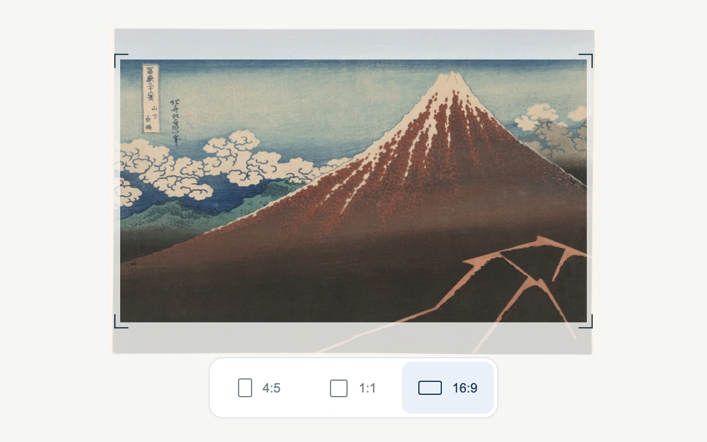

# The changing frame

> A moving aperture reframes a woodblock print while the artwork remains completely still.

- **Common name:** Aspect ratio crop animation
- **Category:** Animation & motion
- **Live demo:** https://www.subframe.com/motion/frame-crop
- **Source:** Subframe (original, MIT)
- **Dependencies:** none

## Use case

Compare publishing formats while preserving subject scale and showing which parts of an artwork will be cropped.

## Interaction

Select a print format

## Look

Off-white page with a Japanese woodblock print of a red mountain, vivid inside corner-marked crop bounds and faded beyond them, above a segmented control.

## Motion

Choosing 4:5, 1:1 or 16:9 animates a clip-path aperture and its corner marks to the new crop over 620 ms with an ease-out, while the artwork stays still.

## How to adapt

The `fc-aperture` clip-path `inset(${y}px ${420 - x - format.width}px ${y}px ${x}px)` and the four fixed-size marks inside `fc-crop-edge` share `620ms cubic-bezier(.22,.8,.18,1)`. Each mark translates to its crop corner without resizing its box; the clip-path still has its own rendering cost. Crops come from `formats` in a fixed 420×278 stage. Replace `src` and `alt`, then match image dimensions and crop offsets.

## Reduced motion

Format and crop position change immediately; the complete artwork remains visible as a faint context layer.

## Limitations

Three authored crop positions, not automatic focal-point detection or a draggable/exporting image editor. Clip-path and bounded frame geometry animate; this is not a compositor-only effect. Sample artwork is a separately declared CC0 asset.

## Taxonomy

- **Components:** image, tabs
- **Triggers:** state, press
- **Techniques:** mask, morph
- **Feel:** refined, subtle
- **Contexts:** app, editorial
- **Tags:** crop, aspect-ratio, aperture, artwork, image, composition, format, reframe, radio
- **Also known as:** crop preview, image format switcher, reframing aperture, social format crop toggle
- **Surface color:** `#f6f6f4`

## Assets

- [`fuji-storm.webp`](../../assets/fuji-storm.webp) — Shower Below the Summit (Sanka hakuu), from Thirty-Six Views of Mount Fuji, Katsushika Hokusai (CC0-1.0)

## Code

See [`component.tsx`](component.tsx).
