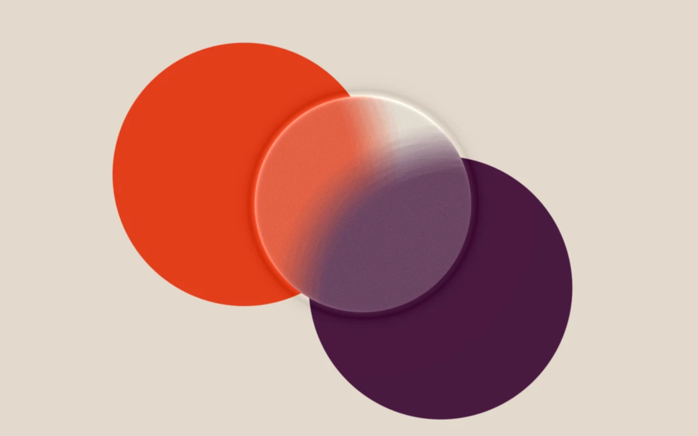

# Frosted orbit

> A satin glass disk softens the intersection of persimmon and plum.

- **Common name:** Frosted glass shader
- **Category:** WebGL & shaders
- **Live demo:** https://www.subframe.com/motion/frosted-orbit
- **Source:** Subframe (original, MIT)
- **Dependencies:** none

## Use case

Glass material studies, cosmetics, or product-reveal masks with deliberate color blocking.

## Interaction

Adjust roughness

## Look

Warm sand-beige ground with overlapping flat persimmon-orange and deep plum circles, and a frosted glass disc with a bright rim blurring their intersection.

## Motion

A frosted glass disc drifts on a slow, small looping path over two flat circles, blurring what lies beneath; a roughness slider widens or narrows the blur; a button pauses.

## How to adapt

In the `FRAGMENT` shader, `center` sets the disc's `u_time` drift, the 36-sample loop blurs `art` with radius `.025+u_control*.055`, and `mask` sets the 0.25 disc radius. Replace `art` with your own shapes or texture; keep the canvas lifecycle and fallback.

## Reduced motion

A representative frame remains still. Live system preference changes immediately stop the loop; the range control continues to update the still image.

## Limitations

Requires WebGL 1. A static CSS fallback appears when unavailable or after context loss. Blurs only included procedural artwork. Does not blur arbitrary DOM or use physical volumetric glass.

## Taxonomy

- **Components:** background
- **Triggers:** ambient, state
- **Techniques:** shader, blur
- **Feel:** refined, calm
- **Contexts:** landing, editorial
- **Tags:** frosted glass, rough transmission, blur, lens, material, native webgl
- **Also known as:** glassmorphism disc, blurred glass lens, satin glass effect, backdrop blur circle
- **Surface color:** `#e7ddd3`

## Code

See [`component.tsx`](component.tsx).
