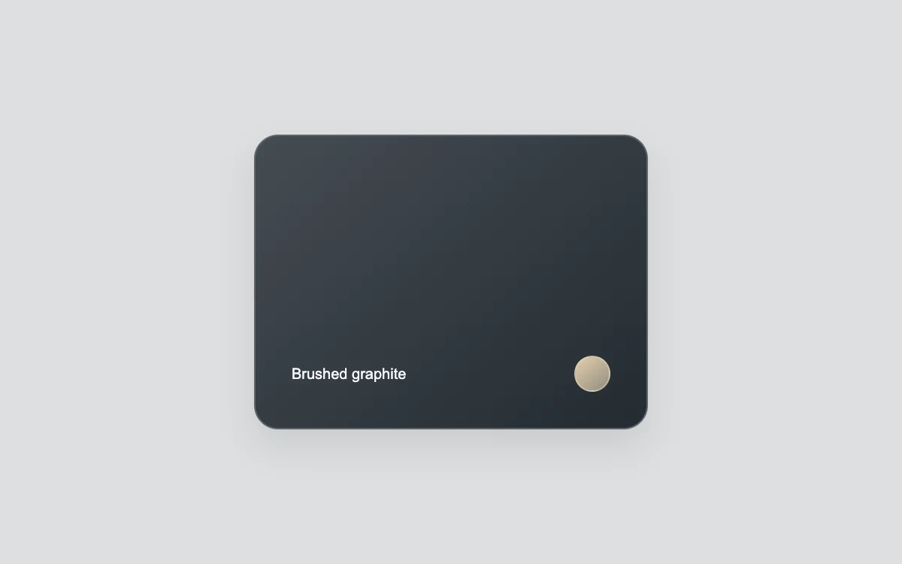

# A glancing reflection

> A diagonal light glides across a dark material card on hover.

- **Common name:** Glare hover card
- **Category:** Components & interactions
- **Live demo:** https://www.subframe.com/motion/glare-hover
- **Source:** Magic UI (adapted, MIT) — https://magicui.design/docs/components/glare-hover · [original code](https://github.com/magicuidesign/magicui/blob/85f97fd27b053339af74ba9dd4ca428ee25989fb/apps/www/registry/magicui/glare-hover.tsx)
- **Dependencies:** none

## Use case

Give a collectible, swatch or featured card a reflective surface.

## Interaction

Hover the card, or click to save it

## Look

Dark graphite rounded card with a subtle diagonal gradient, small white label and a champagne-gold circular swatch, centred on a light grey page.

## Motion

On hover (fine pointers), a soft white diagonal glare band sweeps across the card toward the top-left over 650 ms ease-in-out, returning when the pointer leaves.

## How to adapt

The glare is the card's `::before`: a `-35deg` linear gradient band on a layer sized to 250% of the card. Its `transform` translates from `60%,60%` to `-60%,-60%` on hover over `650ms ease-in-out`. Change the angle, `#ffffff45` band colour and timing; preserve clipping and the stationary reduced-motion highlight.

## Reduced motion

A stationary highlight replaces the traveling reflection.

## Limitations

The reflection translates an oversized gradient layer clipped to the card. Layer promotion is browser-dependent. Touch and keyboard preserve selection; this example saves only in local state.

## Taxonomy

- **Components:** card, button
- **Triggers:** hover
- **Techniques:** glow, gradient
- **Feel:** refined, subtle
- **Contexts:** landing, app
- **Tags:** card, hover, glare, reflection, material, diagonal gradient, click
- **Also known as:** shine on hover card, light sweep effect, glossy card hover, sheen hover, specular highlight sweep
- **Surface color:** `#dddedf`

## Code

See [`component.tsx`](component.tsx).
