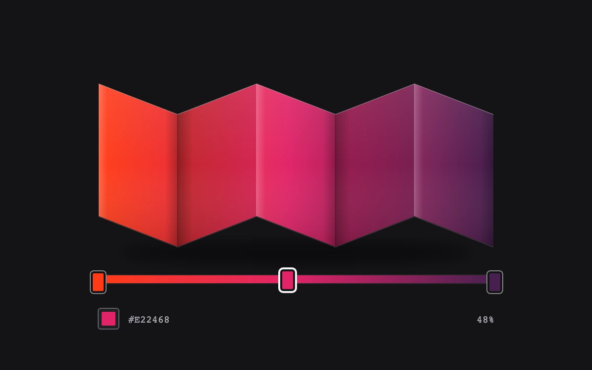

# Folded color proof

> Three movable color stops paint a sharply folded paper proof, making color placement and material shading visible together.

- **Common name:** Gradient stop editor
- **Category:** Components & interactions
- **Live demo:** https://www.subframe.com/motion/gradient-stop-editor
- **Source:** Subframe (original, MIT)
- **Dependencies:** none

## Use case

Art directing a gradient against dimensional artwork rather than judging it only in a flat swatch.

## Interaction

Drag a color stop or use its arrow keys, then edit the selected color

## Look

Near-black canvas with a zigzag folded-paper strip shaded vermilion to magenta to aubergine, above a gradient track with rounded swatch handles and monospace hex readout.

## Motion

Dragging a stop handle or pressing arrow keys moves it along the track and repaints the folded proof's gradient live; the selected handle lifts 2 px over 120 ms.

## How to adapt

Stops live in `stops` (seeded from `initial`); `change` clamps positions and `sorted` feeds both the `gradient` track string and the SVG `linearGradient`. Replace `folds` and the face lighting with your artwork, or bind `gradient` to a real fill.

## Reduced motion

Color and position edits are immediate; reduced motion removes the small selection lift transition.

## Limitations

Three fixed editable stops, original SVG folded-paper geometry, and authored face lighting. No add/remove, CSS parser, color-space conversion, or physically based renderer. Coincident stops remain independently reachable with Tab.

## Taxonomy

- **Components:** editor, slider, picker
- **Triggers:** drag, keyboard
- **Techniques:** gradient
- **Feel:** technical, refined
- **Contexts:** app
- **Tags:** gradient, color, stops, multi-thumb, editor, drag, material, paper, fold, proof, svg
- **Also known as:** gradient editor, color stop slider, multi-thumb gradient slider, gradient builder
- **Surface color:** `#141417`

## Code

See [`component.tsx`](component.tsx).
