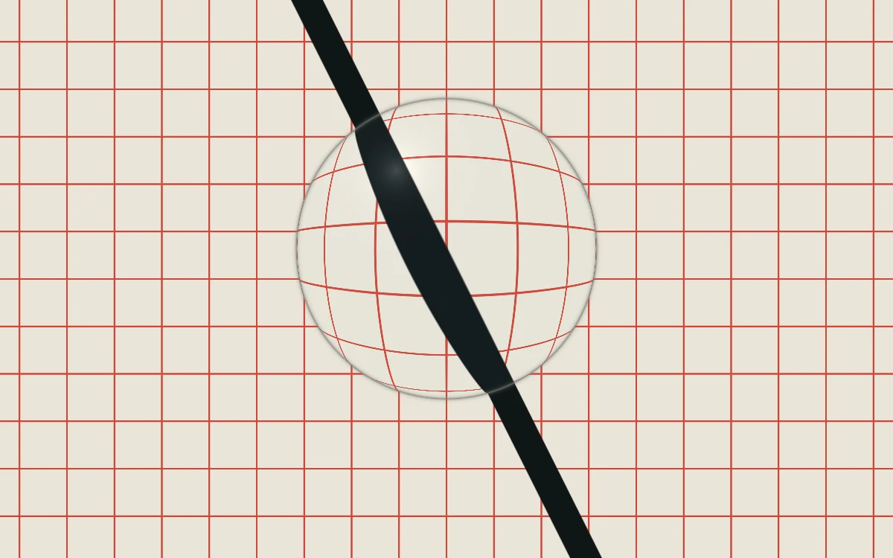

# Gravitational lens

> A hovering lens bends a precise vermilion drafting grid.

- **Common name:** Lens distortion shader
- **Category:** WebGL & shaders
- **Live demo:** https://www.subframe.com/motion/gravitational-lens
- **Source:** Subframe (original, MIT)
- **Dependencies:** none

## Use case

Optical interfaces, scientific identities, and interaction-driven distortions of procedural art.

## Interaction

Adjust position

## Look

Cream drafting paper with a fine vermilion square grid and one bold black diagonal band, magnified by a clear glass disc with a grey rim.

## Motion

A circular lens magnifies the grid beneath it and bobs vertically on a slow sine (about 27 s per cycle); a position slider moves it horizontally; a button pauses.

## How to adapt

The lens is in the `FRAGMENT` shader: `center` takes x from `u_control` plus a `sin(u_time*.23)` bob, `.38` sets magnification, and the 0.27 radius recurs in `mask`, `z` and `rim`; `spacing` sizes the grid. Keep the canvas lifecycle and fallbacks.

## Reduced motion

A representative frame remains still. Live system preference changes immediately stop the loop; the range control continues to update the still image.

## Limitations

Requires WebGL 1. A static CSS fallback appears when unavailable or after context loss. A screen-space lens illustration; the title is metaphorical and does not imply general-relativistic simulation.

## Taxonomy

- **Components:** background
- **Triggers:** ambient, state
- **Techniques:** shader, distortion
- **Feel:** technical, calm
- **Contexts:** landing, editorial
- **Tags:** lens, fisheye, distortion, grid, optics, native webgl
- **Also known as:** magnifying glass effect, fisheye distortion, bulge effect, magnifier lens shader
- **Surface color:** `#ede8db`

## Code

See [`component.tsx`](component.tsx).
