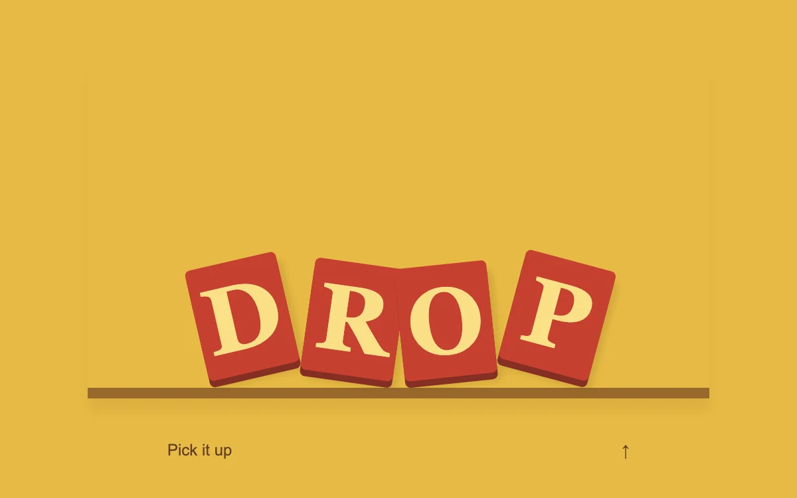

# Let it fall

> Weighted letter tiles drop into a shallow tray and return to their original line.

- **Common name:** Falling letters animation
- **Category:** Animation & motion
- **Live demo:** https://www.subframe.com/motion/gravity-letters
- **Source:** Subframe (original, MIT)
- **Dependencies:** none

## Use case

Add a rare, playful typographic moment to a campaign or a creative empty state.

## Interaction

Drop or reset the letters

## Look

Mustard-yellow field with four red block tiles bearing cream bold serif capitals, resting tilted on a brown shelf, and a small text button below.

## Motion

Pressing the button drops the tiles onto the shelf 35 ms apart with a 0.65 s bounce curve and authored tilts; pressing again lifts them back with 0.35 s ease-out.

## How to adapt

Each tile's inline `transform` drops it to the tray floor and rotates it by `[-13, 8, -6, 15]`, staggered by `transitionDelay`; the bounce is the 0.65 s transition on `.letters span`, the return `cubic-bezier(.22,1,.36,1)`. Replace `"DROP"` and its angles together.

## Reduced motion

Live reduced-motion preferences remove interpolation and decorative playback. All content and native controls remain available. Keyboard changes settle immediately.

## Limitations

A choreographed drop with authored end poses. This does not simulate arbitrary letter collisions or physics.

## Taxonomy

- **Components:** text
- **Triggers:** press
- **Techniques:** split-text, spring, stagger, rotate
- **Feel:** playful
- **Contexts:** landing, editorial
- **Tags:** gravity, typography, fall, tiles, playful
- **Also known as:** gravity text drop, bouncing letter blocks, tumbling letters, dropping letter tiles
- **Surface color:** `#e7bb45`

## Code

See [`component.tsx`](component.tsx).
