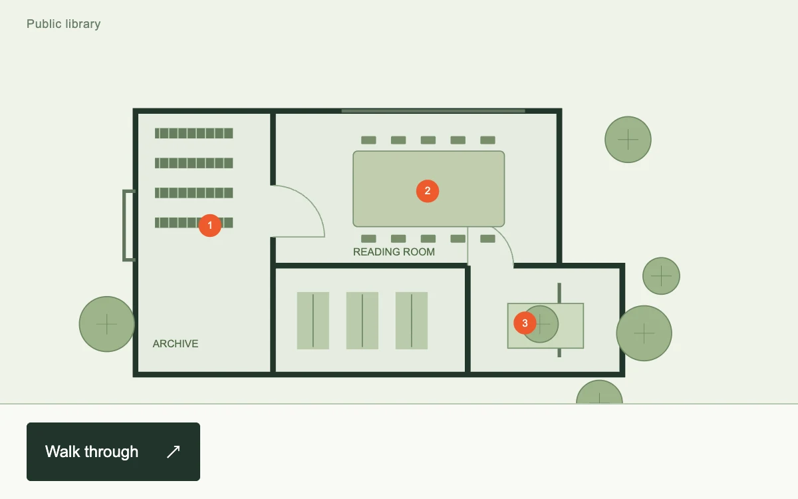

# Guided inspection

> A library plan moves beneath a precisely aligned spotlight as a three-stop walkthrough explores its rooms.

- **Common name:** Product tour spotlight
- **Category:** Components & interactions
- **Live demo:** https://www.subframe.com/motion/guided-inspection
- **Source:** Subframe (original, MIT)
- **Dependencies:** none

## Use case

Guide inspection of a diagram, product or technical illustration through one shared camera transform.

## Interaction

Start the walkthrough; advance through three points or use arrow keys. Escape exits.

## Look

Pale sage floor plan with dark green walls, muted green furniture and round trees, orange numbered hotspots, and a dark green button below.

## Motion

Each step pans and zooms the plan to a room while a dimming mask's cut-out follows, both over 550 ms ease-out; keyboard steps apply instantly, Escape exits.

## How to adapt

The camera is the `gi-camera` group transform and the spotlight the `gi-focus` mask rect, both transitioned with `.55s cubic-bezier(.22,.75,.22,1)`; `tx`, `ty` and `s` centre the stop. Replace the SVG plan and `STOPS` bounds, scales and notes.

## Reduced motion

Camera and spotlight update immediately; the three steps remain available.

## Limitations

A local SVG floor plan, not a DOM element targeting or page-onboarding service.

## Taxonomy

- **Components:** tooltip, image
- **Triggers:** press, keyboard
- **Techniques:** scale, mask
- **Feel:** refined
- **Contexts:** app, editorial
- **Tags:** tour, spotlight, camera, diagram, svg, onboarding, zoom
- **Also known as:** onboarding walkthrough, coach marks, zoom to hotspot, diagram spotlight tour
- **Surface color:** `#eff3e9`

## Code

See [`component.tsx`](component.tsx).
