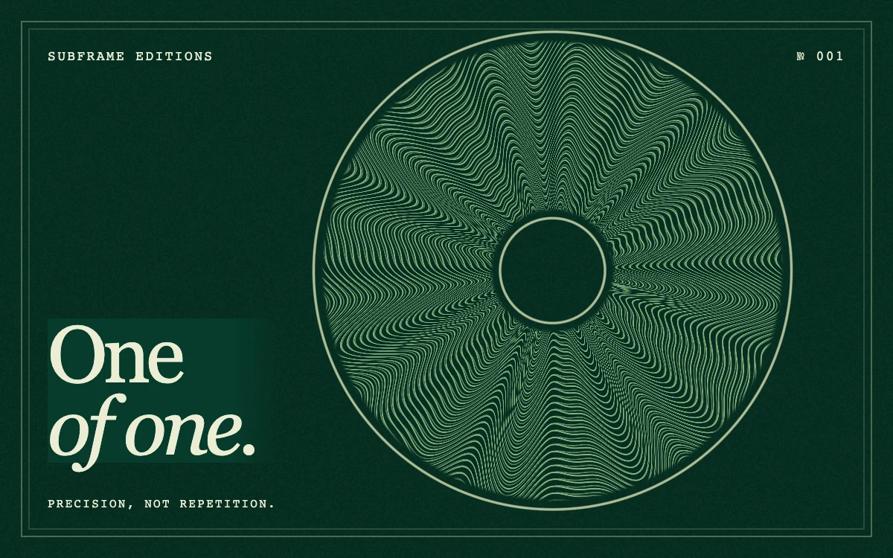

# Guilloché

> Fine engraved rosettes breathe inside a deep green edition print.

- **Common name:** Guilloché pattern shader
- **Category:** WebGL & shaders
- **Live demo:** https://www.subframe.com/motion/guilloche
- **Source:** Subframe (original, MIT)
- **Dependencies:** none

## Use case

Membership credentials, limited-edition launches, cultural invitations, or a distinctive mark of provenance.

## Interaction

Play or pause the material study.

## Look

Deep emerald textured paper with a double hairline frame, a pale-green engraved rosette ring at right, monospace caps and a cream serif headline at left.

## Motion

Two angular petal waves in the rosette drift slowly in opposite directions on the shader clock, so the fine engraved lines continuously undulate; a button pauses.

## How to adapt

The rosette is the `FRAGMENT` shader: `petals` sets the 12- and 19-lobe waves and their `u_time` speeds, `phase` the line density, `medallion` the ring bounds, `paper` and `ink` the colours. Replace the print typography; keep the canvas lifecycle and fallback.

## Reduced motion

Displays one stable, representative frame. Responds immediately when the system preference changes.

## Limitations

Requires WebGL 1; a static CSS composition remains visible when WebGL is unavailable or lost. Fine linework may show moiré at small scales; inspect at the intended display size.

## Taxonomy

- **Components:** background
- **Triggers:** ambient
- **Techniques:** shader
- **Feel:** refined, calm
- **Contexts:** landing, editorial
- **Tags:** guilloche, engraving, security print, rosette, luxury, emerald, editorial, native webgl
- **Also known as:** security print pattern, engraved rosette, banknote line pattern, certificate background
- **Surface color:** `#073b2c`

## Code

See [`component.tsx`](component.tsx).
